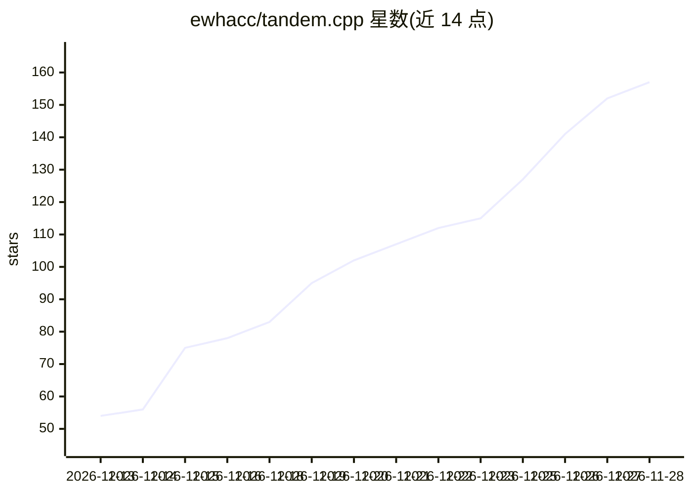

# ewhacc/tandem.cpp

⭐ 157 · Python · NOASSERTION · 推送 2026-11-27 · [GitHub](https://github.com/ewhacc/tandem.cpp) · 个人维护

**llama.cpp 补丁：在显存与内存不足时运行超大 MoE 模型**

对 llama.cpp 的一组补丁，针对超出 GPU 显存甚至超出 RAM 的 MoE 模型：常用专家放入显存缓存，CPU 计算一部分未命中专家，其余从 RAM 或 SSD 读取。适用于 llama.cpp 支持的任意 MoE 模型，单用户场景，附带 Python 启动脚本 tandem-run.py 自动选择参数并启动 OpenAI 兼容 API 的 llama-server。仅支持 Linux，主要针对 NVIDIA CUDA 调优，AMD ROCm 可编译但调优较少。构建方式为脚本克隆 llama.cpp、检出固定基础提交并应用补丁编译。

## 筛选速览

| 维度 | 判定 | 备注 |
|---|---|---|
| AI 角色 | `ai-ecosystem` | LLM/agent 周边工具 |
| 许可风险 | `none` | NOASSERTION |
| 部署形态 | `None` |  |
| 模型依赖 | local-ok | 支持本地模型 |
| 硬件要求 | — | 无带数字的原话,不猜 |
| 安装摩擦 | `high` | 编译与系统依赖俱全 |
| 成熟度 | — | 结构信号不足 |

## 能力要点

- VRAM 缓存 + CPU 分担 + RAM/SSD 读取的 MoE 专家分层加载机制
- CPU/上传比例按本机自动调优并按模型/GPU/内存/线程数持久化
- 启动脚本自动选择参数、给出每个 flag 的理由并下载缺失模型文件
- 支持 MTP/EAGLE3 投机解码，与 OpenAI 兼容 API

## 适用场景

- 在显存和内存都不够装下整个模型时本地运行 MoE 大模型
- 单用户场景下用消费级 GPU + 有限内存获得可用解码速度
- 为 llama.cpp 支持的任意 MoE GGUF 生成调优后的启动命令

## 场景标签

`推理引擎` · 领域:训练与推理

## 证据(README 行号)

> L3: tandem.cpp is a patch set for llama.cpp that runs MoE models much larger than your
> L48: bash build.sh            # clones llama.cpp into ./tandem, checks out the base commit, applies tandem.patch, builds
> L87: foreground. When it prints `URL: http://127.0.0.1:8080/` the OpenAI-compatible API is ready at `/v1`.

## 星数曲线

2026-11-13 54 → 2026-11-28 157（+103）

---
*卡片 v1 · prompt 1.4 · 生成 2026-11-28 · 置信度 high · 依据 README sha `fabc929657e7` · [字段定义](../../DATASET.md)*
