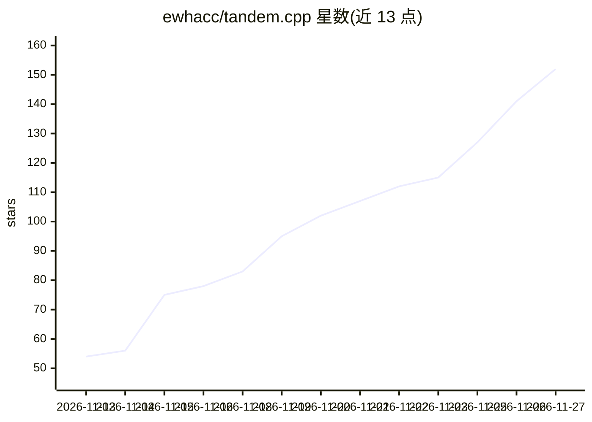

# ewhacc/tandem.cpp

⭐ 152 · Python · NOASSERTION · 推送 2026-11-26 · [GitHub](https://github.com/ewhacc/tandem.cpp) · 个人维护

**llama.cpp 补丁：让超出显存的 MoE 模型在 GPU+CPU+RAM 分层下运行**

针对 llama.cpp 的补丁集，目标场景是 MoE 模型权重超过 GPU 显存甚至内存的情况：常用专家驻留 VRAM 缓存，CPU 计算部分 miss，其余从 RAM 或 SSD 读取。支持 llama.cpp 所兼容的任意 MoE 模型，单用户使用，通过 llama-server 暴露 OpenAI 兼容 API。README 给出与其它引擎同机同时的 decode 速度与 KL 散度数据。限制：仅 Linux、逐 token 输出不可复现（greedy）、并发收益有限、多 GPU 仅支持默认分层模式。

## 筛选速览

| 维度 | 判定 | 备注 |
|---|---|---|
| AI 角色 | `ai-ecosystem` | LLM/agent 周边工具 |
| 许可风险 | `none` | NOASSERTION |
| 部署形态 | `None` |  |
| 模型依赖 | local-ok | 支持本地模型 |
| 硬件要求 | — | 无带数字的原话,不猜 |
| 安装摩擦 | `high` | 编译与系统依赖俱全 |
| 成熟度 | — | 结构信号不足 |

## 能力要点

- VRAM 专家缓存 + CPU 计算 + RAM/SSD 读取的三级卸载机制
- CPU/上传比例自调优并按机型缓存结果
- 提供单文件启动器 tandem-run.py，自动生成 llama-server 参数
- 支持 MTP/EAGLE3 投机解码，附选型 KL 数据表

## 适用场景

- 显存装不下 100 GB+ 的 MoE GGUF 模型时本地推理
- 16 GB 显卡 + 64 GB 内存的主机跑大权重模型
- 本地启动 llama-server 并通过 OpenAI 兼容接口调用

## 场景标签

`推理引擎` · 领域:训练与推理

## 证据(README 行号)

> L3: tandem.cpp is a patch set for llama.cpp that runs MoE models much larger than your
> L48: bash build.sh            # clones llama.cpp into ./tandem, checks out the base commit, applies tandem.patch, builds

## 星数曲线

2026-11-13 54 → 2026-11-27 152（+98）

---
*卡片 v1 · prompt 1.4 · 生成 2026-11-27 · 置信度 high · 依据 README sha `21dc5cd1be65` · [字段定义](../../DATASET.md)*
