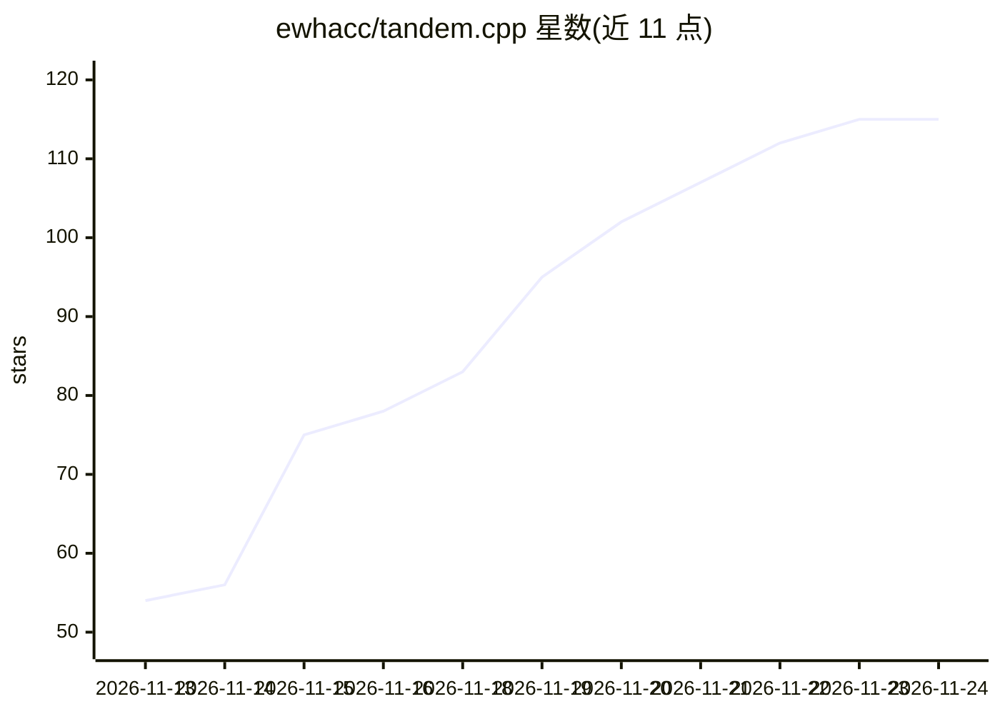

# ewhacc/tandem.cpp

⭐ 127 · Python · NOASSERTION · 推送 2026-11-23 · [GitHub](https://github.com/ewhacc/tandem.cpp) · 个人维护

**llama.cpp 补丁集：让超出 VRAM 的 MoE 模型本地解码更快**

tandem.cpp 是针对 llama.cpp 基础提交 f5222f25c 的独立补丁集（v0.3.0），面向单用户解码场景：将高频使用的专家保留在 GPU，其余专家由 CPU/RAM 协同处理，适用于任何 llama.cpp 支持的 MoE 模型。v0.3.0 将提示批处理从 512 token 扩大到 4096 并在提示期间借用专家缓存的 VRAM。提供 build.sh 一键构建脚本与 tandem-run.py 启动器（Linux + NVIDIA），启动后提供 OpenAI 兼容 API。附带 Maya GGUF 转换工具。AMD 需 HIP 构建，tandem-run.py 不支持 NVIDIA 以外的卡。

## 筛选速览

| 维度 | 判定 | 备注 |
|---|---|---|
| AI 角色 | `ai-ecosystem` | LLM/agent 周边工具 |
| 许可风险 | `none` | NOASSERTION |
| 部署形态 | `None` |  |
| 模型依赖 | local-ok | 支持本地模型 |
| 硬件要求 | — | 无带数字的原话,不猜 |
| 安装摩擦 | `high` | 编译与系统依赖俱全 |
| 成熟度 | — | 结构信号不足 |

## 能力要点

- 以补丁形式作用于 llama.cpp 基础提交 f5222f25c
- 高频专家驻留 GPU、其余专家由 CPU/RAM 处理的 MoE 卸载机制
- v0.3.0 支持 4096-token 提示批处理，提示期间向专家缓存借用 VRAM
- tandem-run.py 启动器自动选择参数并运行 llama-server，提供 OpenAI 兼容 API

## 适用场景

- 在 16–32 GB 显存 + RAM 的单用户 PC 上运行超出显存的 MoE 模型
- 模型大于 RAM 时用 VRAM+RAM 联合专家缓存减少 SSD 读取
- 本地跑 Qwen3.8 / gpt-oss-120b / DeepSeek-V4.1 等 GGUF 模型并获得 OpenAI 兼容接口

## 场景标签

`推理引擎` · 领域:训练与推理

## 证据(README 行号)

> L3: tandem.cpp is a patch set for llama.cpp. It makes MoE models that don't fit in VRAM run faster in llama.cpp. It keep
> L107: bash build.sh            # clones llama.cpp into ./tandem, checks out the base commit, applies tandem.patch, build

## 星数曲线

2026-11-13 54 → 2026-11-24 115（+61）

---
*卡片 v1 · prompt 1.4 · 生成 2026-11-18 · 置信度 high · 依据 README sha `ed2b1a8b4e85` · [字段定义](../../DATASET.md)*
