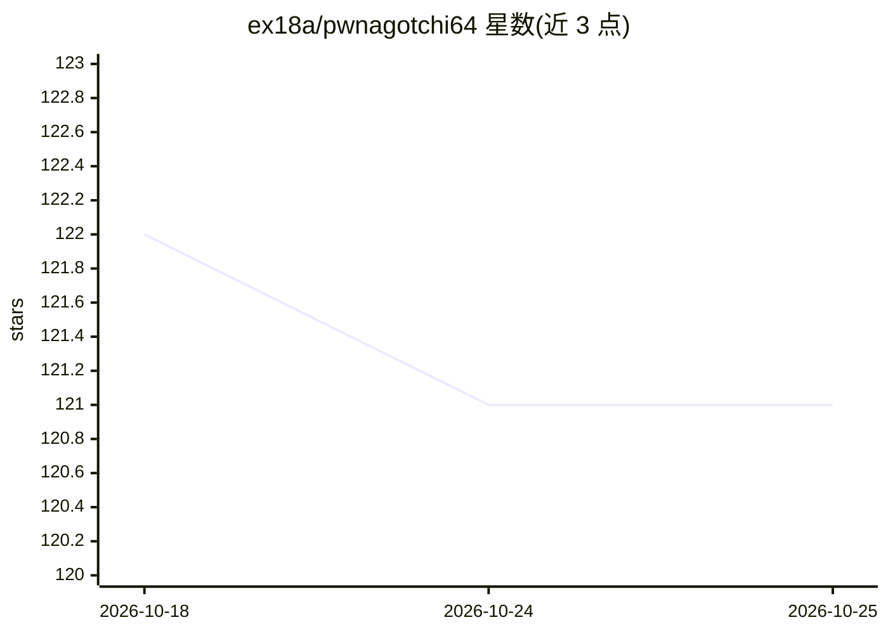

# ex18a/pwnagotchi64

⭐ 121 · JavaScript · NOASSERTION · 推送 2026-09-19 · [GitHub](https://github.com/ex18a/pwnagotchi64) · 个人维护

**在树莓派上用强化学习自动调优 WiFi 审计工具 bettercap 的便携设备镜像**

Pwnagotchi 的 64 位分支：底层 WiFi 攻击（去认证、关联、抓握手包）全部由 bettercap 完成，强化学习只负责学习如何运行 bettercap——信道停留时长、跳信道力度、放弃目标的等待时间等参数，以每个 epoch 抓到的握手包等作为奖励信号迭代调参。本分支改用 PyTorch/stable-baselines3 与 Kali Linux 64 位基础镜像（原生 Nexmon 支持），针对 Raspberry Pi Zero 2 W 与 waveshare 2.13 寸墨水屏优化；通过 Docker 构建可刷写镜像。

## 筛选速览

| 维度 | 判定 | 备注 |
|---|---|---|
| AI 角色 | `ai-enhanced` | 去掉 AI 部分产品仍成立 |
| 许可风险 | `none` | NOASSERTION |
| 部署形态 | `None` |  |
| 模型依赖 | — | README 未给出锁定关系 |
| 硬件要求 | — | 无带数字的原话,不猜 |
| 安装摩擦 | `low` | 无编译、无系统依赖或容器化 |
| 成熟度 | — | 结构信号不足 |

## 能力要点

- 强化学习核心每 epoch 根据握手捕获结果迭代调整 bettercap 运行参数
- 64 位 PyTorch/stable-baselines3 替代原 32 位 TensorFlow A2C
- Kali Linux 基础镜像，原生 Nexmon 监听模式与注入支持
- Docker 隔离环境一键 make 构建可刷写 SD 卡镜像

## 适用场景

- 带在身边的便携 WiFi 审计设备，自动适应不同环境的抓包策略
- 在 Raspberry Pi Zero 2 W + 墨水屏上运行带表情界面的 pwnagotchi
- 用 64 位镜像获得比原版更快的 epoch 处理与更稳定的训练

## 场景标签

`网络安全` · 领域:学习与行业

## 证据(README 行号)

> L10: associating, capturing handshakes — is all done by **bettercap**; a
> L11: lot of people assume the "AI" is what's hacking the WiFi, but it isn't. What the AI does is learn

## 星数曲线

2026-10-18 122 → 2026-10-25 121（-1）

---
*卡片 v1 · prompt 1.4 · 生成 2026-10-23 · 置信度 mid · 依据 README sha `f2f9b0f8b9f9` · [字段定义](../../DATASET.md)*
