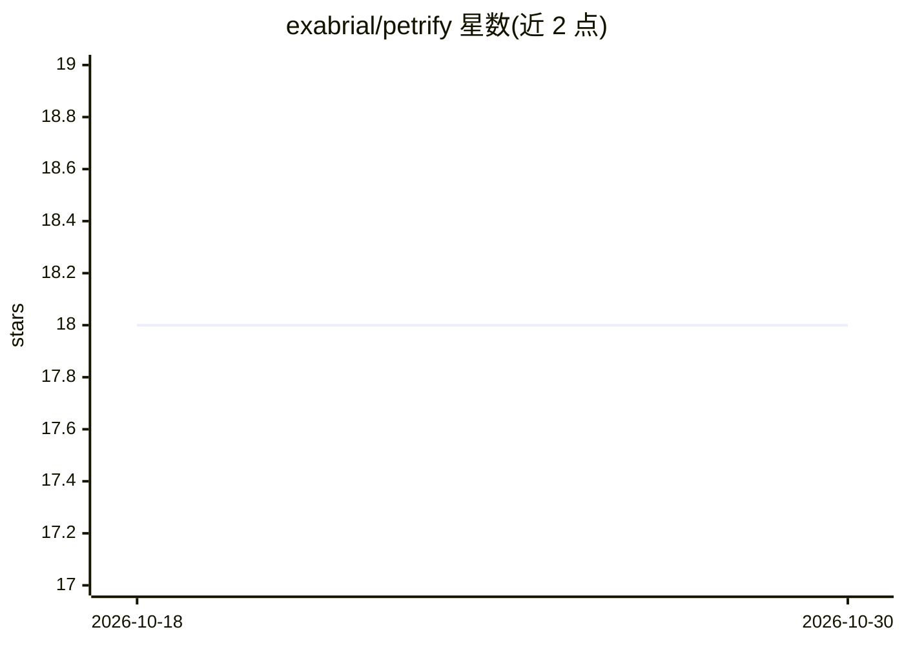

# exabrial/petrify

⭐ 18 · Java · EUPL-1.2 · 推送 2026-09-18 · [GitHub](https://github.com/exabrial/petrify) · 个人维护

**将 ONNX/LightGBM/scikit-learn 模型编译为 JVM 字节码的编译器**

面向 JVM 的机器学习模型编译器：读取 ONNX、LightGBM 原生文本或 scikit-learn JSON 格式的树模型与线性模型，遍历树结构并把模型编码为等价的无状态 JVM 字节码类（Fossil），执行时只做比较、条件跳转与算术运算。执行树模型每次调用仅一次堆分配以保证线程安全。编译需 JDK 25，编译产物可在 JDK 17+ 运行，运行期仅依赖 ASL2 许可的 petrify-model 接口。支持 XGBoost、LightGBM、CatBoost、scikit-learn 多种框架导出的模型，提供 Maven 插件在构建期预编译。限制：不支持字符串类标签，SVM 算子为计划中。

## 筛选速览

| 维度 | 判定 | 备注 |
|---|---|---|
| AI 角色 | `ai-ecosystem` | LLM/agent 周边工具 |
| 许可风险 | `dual` | EUPL-1.2 |
| 部署形态 | `None` |  |
| 模型依赖 | — | README 未给出锁定关系 |
| 硬件要求 | — | 无带数字的原话,不猜 |
| 安装摩擦 | `medium` | 含编译或系统依赖之一 |
| 成熟度 | — | 结构信号不足 |

## 能力要点

- 读取 ONNX / LightGBM 原生 / scikit-learn JSON 三种格式，编译为 JVM 字节码
- 树模型执行时每次调用仅一次堆分配，线程安全
- 编译后无执行运行时依赖，仅需 ASL2 许可的 Fossil 接口
- 提供 Maven 插件在构建期把模型编译进 JAR

## 适用场景

- 在 Java 服务中低开销运行 XGBoost/LightGBM 树模型推理
- 构建期把 ML 模型编译为字节码打包进 JAR，避免引入推理运行时
- 对延迟敏感且要求输出确定性的 JVM 端模型执行

## 场景标签

`推理引擎` · 领域:训练与推理

## 证据(README 行号)

> L11: Petrify is a ultralight machine learning model compiler for the the JVM. It reads your model from an ONNX, LightGBM
> L15: This differs from every other ONNX Runtime that I know of, which are essentially interpreters and are reading data 

## 星数曲线

2026-10-18 18 → 2026-10-30 18（+0）

---
*卡片 v1 · prompt 1.4 · 生成 2026-10-29 · 置信度 high · 依据 README sha `4eb60469acf3` · [字段定义](../../DATASET.md)*
