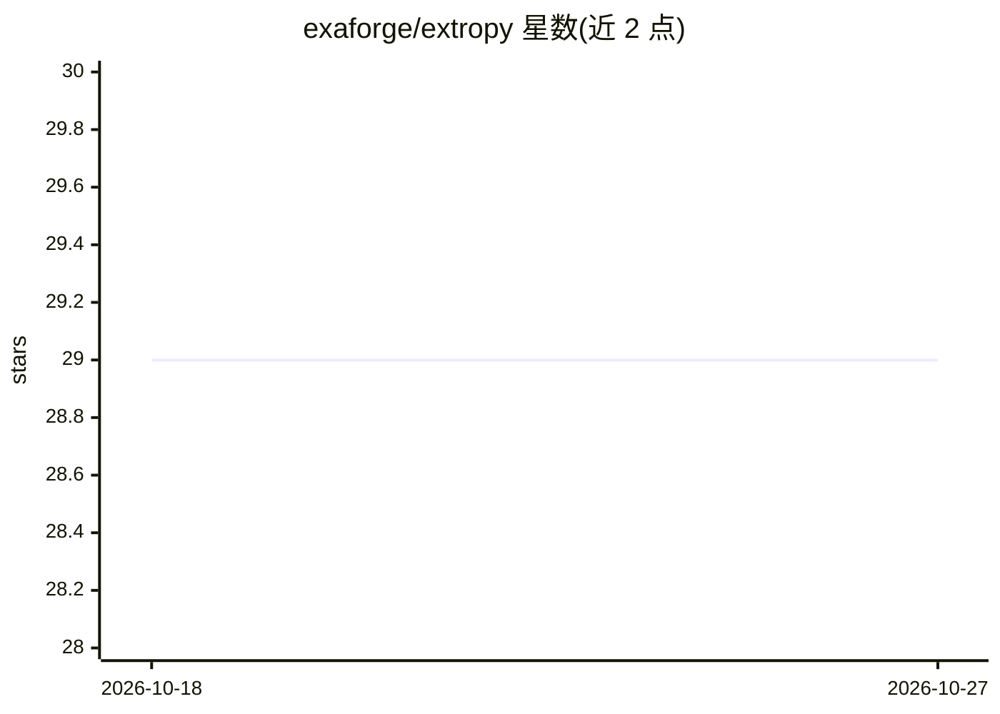

# exaforge/extropy

⭐ 29 · Python · MIT · 推送 2026-02-26 · [GitHub](https://github.com/exaforge/extropy) · [官网](https://extropy.run) · 个人维护

**基于 LLM agent 的人群模拟框架：预测群体对事件的意见与决策**

Python 框架，用 LLM 构建符合真实人口分布的合成群体，将其连接为社会网络，逐个 agent 推理模拟对政策、定价、产品发布等事件的反应。机制包括：LLM 研究真实人口统计数据并采样 agent、结构边+相似性边组网、两遍推理（先角色扮演后分类提取）、意见传播与持久记忆，输出分类/布尔/数值/开放式结果。安装需 pip install extropy-run 并配置 OpenAI/Anthropic/Azure API key。README 声明仍处于活跃开发期，行为可能随版本变化，推荐通过 agent 工具运行，建议从约 500 个 agent 起步小规模试跑。

## 筛选速览

| 维度 | 判定 | 备注 |
|---|---|---|
| AI 角色 | `ai-native` | 本体是模型或模型工具 |
| 许可风险 | `permissive` | MIT |
| 部署形态 | `library` | 以包/库形式分发 |
| 模型依赖 | — | README 未给出锁定关系 |
| 硬件要求 | — | 无带数字的原话,不猜 |
| 安装摩擦 | `low` | 无编译、无系统依赖或容器化 |
| 成熟度 | `idea` | |

## 能力要点

- LLM 基于真实人口分布生成合成群体
- 结构边+相似性边构建社会网络，意见沿网络传播
- 两遍推理：先角色扮演反应，再由分类器提取结果
- 支持分类/布尔/浮点/开放式四类结果输出

## 适用场景

- 模拟政策变化或危机事件下的公众意见演变
- 产品发布或定价决策前的群体反应预测
- 研究观点动态与社会网络中的信息传播

## 场景标签

`Agent 框架` `科研工具` · 领域:Agent 开发

## 证据(README 行号)

> L15: Extropy creates synthetic populations grounded in real-world distributions, connects them in social networks, and s
> L47: 1. **Population** — LLM discovers attributes, researches real-world distributions, samples agents

## 星数曲线

2026-10-18 29 → 2026-10-27 29（+0）

---
*卡片 v1 · prompt 1.4 · 生成 2026-10-26 · 置信度 high · 依据 README sha `ec16d274008a` · [字段定义](../../DATASET.md)*
