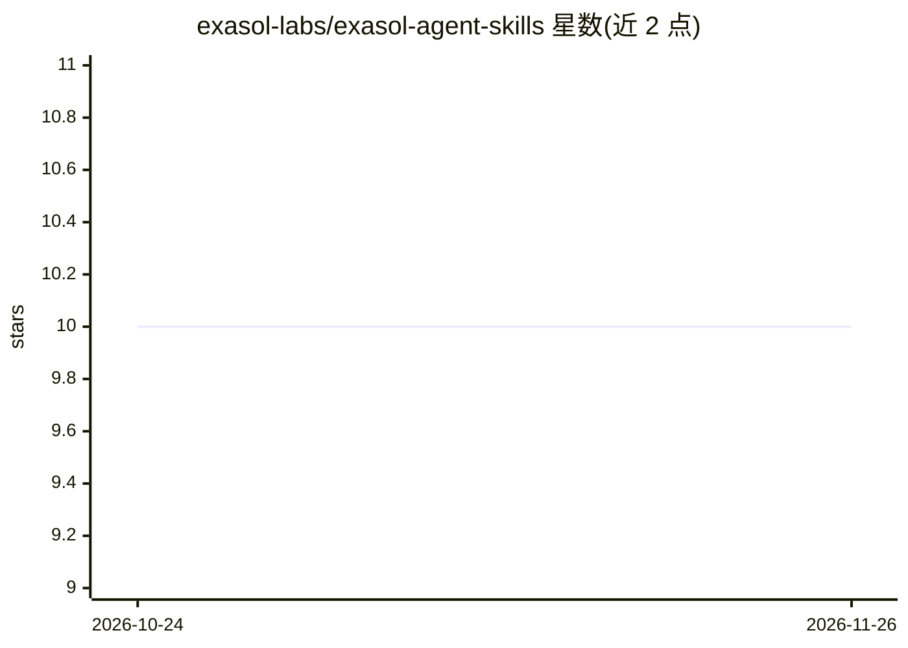

# exasol-labs/exasol-agent-skills

⭐ 10 · Shell · MIT · 推送 2026-10-27 · [GitHub](https://github.com/exasol-labs/exasol-agent-skills) · 组织维护

**面向 AI agent 的 Exasol 数据库操作技能集**

为 Claude Code 与 OpenAI Codex 提供的 Exasol 数据库指导技能库，通过 /exasol 命令或自然语言调用。覆盖 SQL 与表设计、数据导入导出与云存储扩展、虚拟 schema 与适配器开发、UDF 与分布式 ML、PyExasol 与 notebook-connector 等主题。提供交互式与非交互式安装脚本，支持按 agent 选择安装范围，可选安装 exapump。需访问 Exasol 数据库，Claude 集成需 Claude CLI，Codex 集成需 Node.js。

## 筛选速览

| 维度 | 判定 | 备注 |
|---|---|---|
| AI 角色 | `ai-knowledge` | 知识聚合/清单类 |
| 许可风险 | `permissive` | MIT |
| 部署形态 | `None` |  |
| 模型依赖 | — | README 未给出锁定关系 |
| 硬件要求 | — | 无带数字的原话,不猜 |
| 安装摩擦 | `low` | 无编译、无系统依赖或容器化 |
| 成熟度 | — | 结构信号不足 |

## 能力要点

- 安装脚本支持选择 Claude Code、Codex 或两者
- 覆盖 SQL、导入导出、虚拟 schema、UDF、分布式 ML 等 Exasol 主题
- 支持 Claude plugin marketplace 手动安装与更新

## 适用场景

- 在 Claude Code 中用自然语言查询和操作 Exasol 数据库
- 让 agent 完成 CSV 上传到表、导出 parquet 等数据搬运任务
- 为 Exasol 部署选择合适的扩展与集成方案

## 场景标签

`数据分析` · 领域:效率与自动化

## 证据(README 行号)

> L7: Skills for Claude Code and OpenAI Codex that provide focused Exasol guidance.
> L58: - SQL, schema, table-design, reserved-keyword, and exapump guidance.
> L83: |Access to an Exasol database|Database workflows|

## 星数曲线

2026-10-24 10 → 2026-11-26 10（+0）

---
*卡片 v1 · prompt 1.4 · 生成 2026-11-19 · 置信度 high · 依据 README sha `4acc19180102` · [字段定义](../../DATASET.md)*
