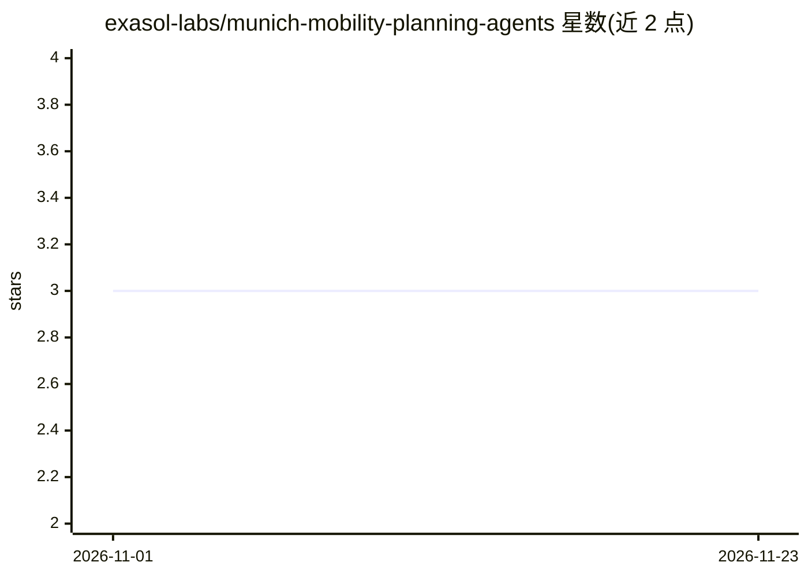

# exasol-labs/munich-mobility-planning-agents

⭐ 3 · Python · 推送 2026-11-05 · [GitHub](https://github.com/exasol-labs/munich-mobility-planning-agents) · 组织维护

**教程：用 AI agent 分析慕尼黑交通开放数据并搭建规划仪表盘**

一个分步教程：将慕尼黑开放交通与人口数据加载到本地 Exasol 数据库，配合 AI 编码 agent（Codex 或 Claude Code）经 MCP 连接，逐步生成回答慕尼黑各区公交服务水平及 2045 年规划影响的系列仪表盘。教程分 10 个章节，从搭建 Exasol Personal Local Starter Kit（数据库、Dash Server、MCP 接入）到加载数据、构建 v1-v5 仪表盘；v5 页面助手需 OpenAI API key。数据为 MVV 时刻表，不含客流、延误信息。

## 筛选速览

| 维度 | 判定 | 备注 |
|---|---|---|
| AI 角色 | `ai-knowledge` | 知识聚合/清单类 |
| 许可风险 | `none` | — |
| 部署形态 | `desktop` | 安装包/桌面程序 |
| 模型依赖 | — | README 未给出锁定关系 |
| 硬件要求 | — | 无带数字的原话,不猜 |
| 安装摩擦 | `low` | 无编译、无系统依赖或容器化 |
| 成熟度 | — | 结构信号不足 |

## 能力要点

- 10 章节分步教程，覆盖数据加载到仪表盘构建全流程
- 通过 MCP 将 AI 编码 agent（Codex/Claude Code）接入 Exasol 数据库
- 含 AGENTS.md 常驻指令与 v5 页面助手上下文包
- 提供可选脚本从慕尼黑开放数据门户重建数据集

## 适用场景

- 学习如何让 AI agent 读写 SQL 并生成分析仪表盘
- 基于慕尼黑公开交通与人口数据做交通规划分析
- 体验 Exasol Personal 本地数据库与 MCP 工作流

## 场景标签

`教程课程` · 领域:学习与行业

## 证据(README 行号)

> L5:  A hands-on tutorial for AI-assisted analytics on Exasol Personal
> L7: You load open data from the City of Munich into a local Exasol database on your laptop. Then you work with an AI cod

## 星数曲线

2026-11-01 3 → 2026-11-23 3（+0）

---
*卡片 v1 · prompt 1.4 · 生成 2026-11-22 · 置信度 high · 依据 README sha `0ee6850988d7` · [字段定义](../../DATASET.md)*
