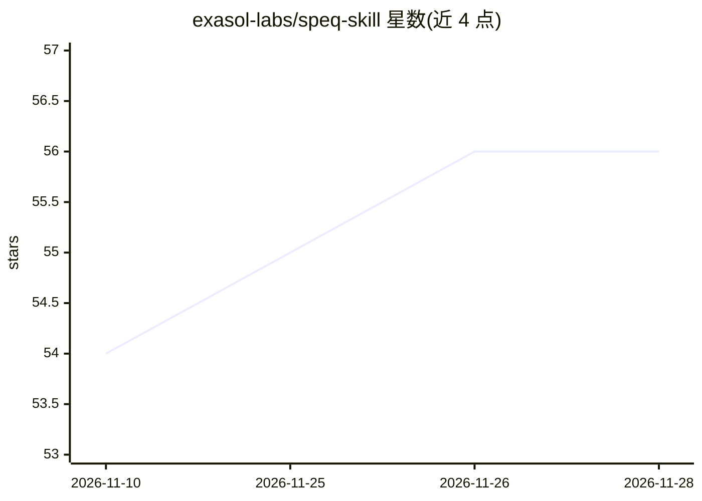

# exasol-labs/speq-skill

⭐ 56 · Rust · MIT · 推送 2026-11-20 · [GitHub](https://github.com/exasol-labs/speq-skill) · 组织维护

**给 Claude Code/Codex 的规格驱动开发插件，含 speq CLI**

面向 Claude Code、Codex 及兼容 AI 编码代理的插件，提供轻量级规格驱动（spec-driven）开发工作流：mission → plan → implement → record 循环，配合 Rust 编写的 speq CLI 列出与读取持久化规格库。规格按 specs/<domain>/<feature>/spec.md 组织，编码代理在规划与实现时仅读取相关规格以避免上下文冗余；小修改可用 /speq:patch 一步完成。安装通过 setup.sh 下载预编译二进制（Linux x86_64/ARM64、macOS Apple Silicon）并注册技能。项目本身只提供工作流结构与规格管理，代码与规格均由编码代理生成。

## 筛选速览

| 维度 | 判定 | 备注 |
|---|---|---|
| AI 角色 | `ai-ecosystem` | LLM/agent 周边工具 |
| 许可风险 | `permissive` | MIT |
| 部署形态 | `None` |  |
| 模型依赖 | — | README 未给出锁定关系 |
| 硬件要求 | — | 无带数字的原话,不猜 |
| 安装摩擦 | `low` | 无编译、无系统依赖或容器化 |
| 成熟度 | — | 结构信号不足 |

## 能力要点

- mission/plan/implement/record 规格驱动工作流
- Rust 编写的 speq CLI 列出并读取持久规格库
- 规格按域组织、按需读取以减少上下文占用
- 提供 /speq:patch 与 /speq:patch-pr 快速修补路径

## 适用场景

- 在 Claude Code 或 Codex 中以规格驱动方式开发功能
- 跨语言/框架项目维护持久化规格库
- 小修补不走完整规划、直接生成 PR

## 场景标签

`编码 Agent` · 领域:编码与开发

## 证据(README 行号)

> L34: This is a plugin for Claude Code or Codex for lightweight spec-driven development with the following characteristic
> L42: It combines skills with a simple CLI called `speq` that lists and reads the permanent spec library. The coding agen
> L76: `speq-skill` is a plugin for Claude Code, Codex, and other compatible AI coding agents. This project provides workf

## 星数曲线

2026-11-10 54 → 2026-11-28 56（+2）

---
*卡片 v1 · prompt 1.4 · 生成 2026-11-18 · 置信度 high · 依据 README sha `605dbcd2de0d` · [字段定义](../../DATASET.md)*
