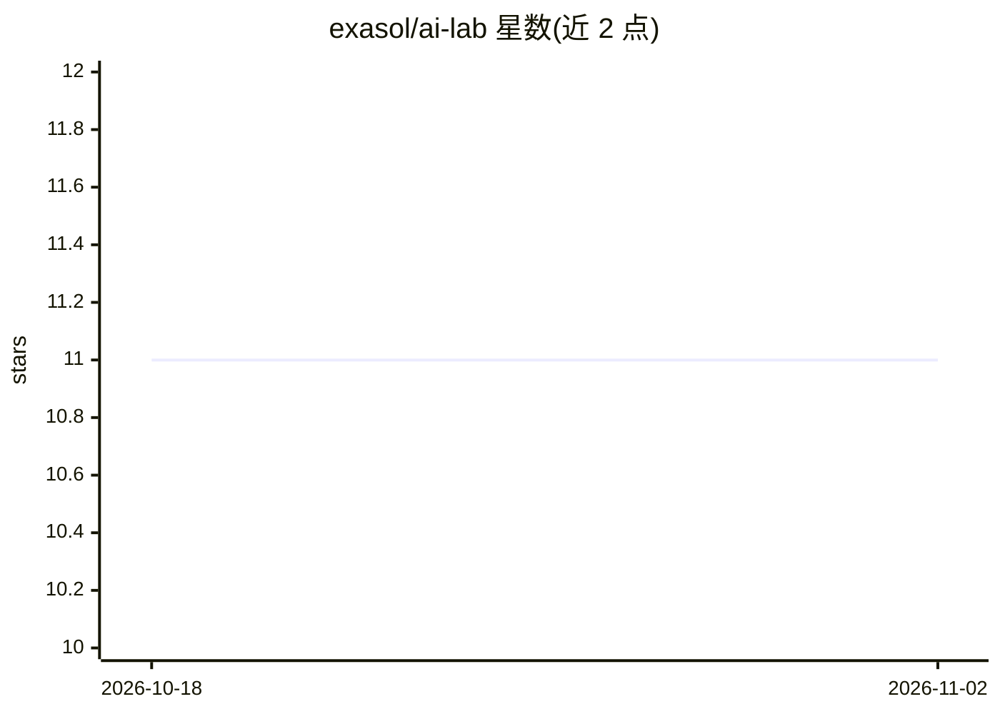

# exasol/ai-lab

⭐ 11 · Python · MIT · 推送 2026-10-29 · [GitHub](https://github.com/exasol/ai-lab) · 组织维护

**面向数据科学家的预配置 AI/ML 开发容器环境**

Exasol 提供的预配置容器，内含 Jupyter Notebook 环境、Exasol 数据库集成包与扩展、示例 notebook（含 scikit-learn 场景与 Hugging Face 模型调用），支持生成式 AI（transformer/LLM）与传统机器学习工作流，覆盖数据加载、准备、探索、训练与部署。通过 Docker 镜像运行，浏览器访问 49494 端口进入 Web 界面（默认密码 ailab），可连接既有 Exasol 数据库或在另一容器中启动独立数据库。

## 筛选速览

| 维度 | 判定 | 备注 |
|---|---|---|
| AI 角色 | `ai-ecosystem` | LLM/agent 周边工具 |
| 许可风险 | `permissive` | MIT |
| 部署形态 | `self-host` | docker 或自建部署 |
| 模型依赖 | — | README 未给出锁定关系 |
| 硬件要求 | — | 无带数字的原话,不猜 |
| 安装摩擦 | `low` | 无编译、无系统依赖或容器化 |
| 成熟度 | — | 结构信号不足 |

## 能力要点

- Jupyter Notebook 环境为核心的容器化开发环境
- 内置 Exasol 集成包、扩展与配置任务
- 示例 notebook 覆盖 scikit-learn 与 Hugging Face 模型场景
- 支持 transformer 与 LLM 相关的生成式 AI 探索工具与库

## 适用场景

- 在 Exasol 数据库之上搭建 AI/ML 工作流开发环境
- 通过示例 notebook 快速上手机器学习与 Hugging Face 模型场景
- 在隔离容器中探索生成式 AI 与传统数据科学任务

## 场景标签

`数据分析` · 领域:效率与自动化

## 证据(README 行号)

> L3: The Exasol AI Lab is a pre-configured container designed to empower data scientists to build AI & ML workflows on to
> L9: * **Generative AI Support**: AI Lab is equipped with tools and libraries to help you explore generative AI technique

## 星数曲线

2026-10-18 11 → 2026-11-02 11（+0）

---
*卡片 v1 · prompt 1.4 · 生成 2026-11-02 · 置信度 high · 依据 README sha `ddf955f051e8` · [字段定义](../../DATASET.md)*
