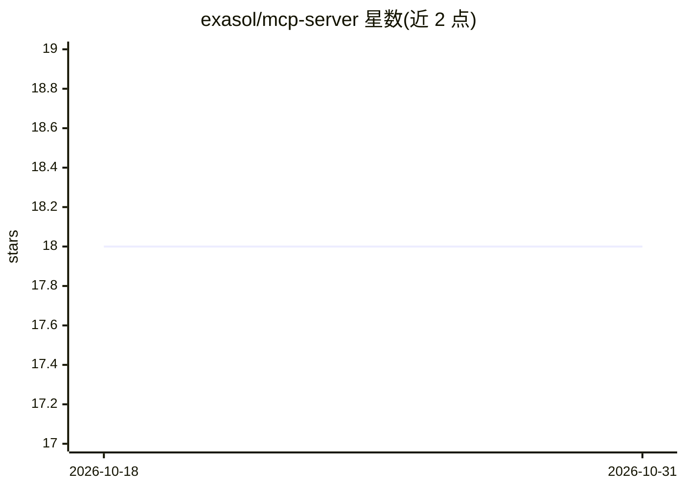

# exasol/mcp-server

⭐ 18 · Python · MIT · 推送 2026-10-30 · [GitHub](https://github.com/exasol/mcp-server) · [官网](https://exasol.github.io/mcp-server/main/index.html) · 组织维护

**让 LLM 通过 MCP 访问 Exasol 数据库的服务器**

Exasol 官方维护的 Model Context Protocol 服务器，为 MCP 客户端（如 Claude Desktop）提供两类工具：枚举与描述数据库对象元数据（schema、表、视图、函数、UDF 脚本，支持过滤与关键词搜索），以及执行 SQL 只读查询。要求 Python>=3.11，通过 uv/uvx 安装或临时运行，可用环境变量与 JSON 文件配置，支持本地 stdio 与远程 HTTP 两种部署模式。README 附有授予 AI 代理数据库访问权限的安全风险声明。

## 筛选速览

| 维度 | 判定 | 备注 |
|---|---|---|
| AI 角色 | `ai-ecosystem` | LLM/agent 周边工具 |
| 许可风险 | `permissive` | MIT |
| 部署形态 | `library` | 以包/库形式分发 |
| 模型依赖 | — | README 未给出锁定关系 |
| 硬件要求 | — | 无带数字的原话,不猜 |
| 安装摩擦 | `low` | 无编译、无系统依赖或容器化 |
| 成熟度 | — | 结构信号不足 |

## 能力要点

- 枚举并描述 Exasol 数据库对象元数据（含列、约束、参数）
- 执行 SQL 数据读取查询
- 支持本地与远程 HTTP 两种运行模式，可自定义 ASGI 部署
- 通过环境变量与可选 JSON 文件配置

## 适用场景

- 在 Claude Desktop 等 MCP 客户端中查询 Exasol 数据库
- 让 AI 代理读取数据库元数据以了解数据结构
- 以远程 HTTP 方式部署 MCP 服务器供团队接入

## 场景标签

`数据分析` · 领域:效率与自动化

## 证据(README 行号)

> L3: Provides an LLM access to the Exasol database via MCP tools. Includes the
> L4: tools for reading the database metadata and executing data reading queries.

## 星数曲线

2026-10-18 18 → 2026-10-31 18（+0）

---
*卡片 v1 · prompt 1.4 · 生成 2026-10-29 · 置信度 high · 依据 README sha `990d6254bfbb` · [字段定义](../../DATASET.md)*
