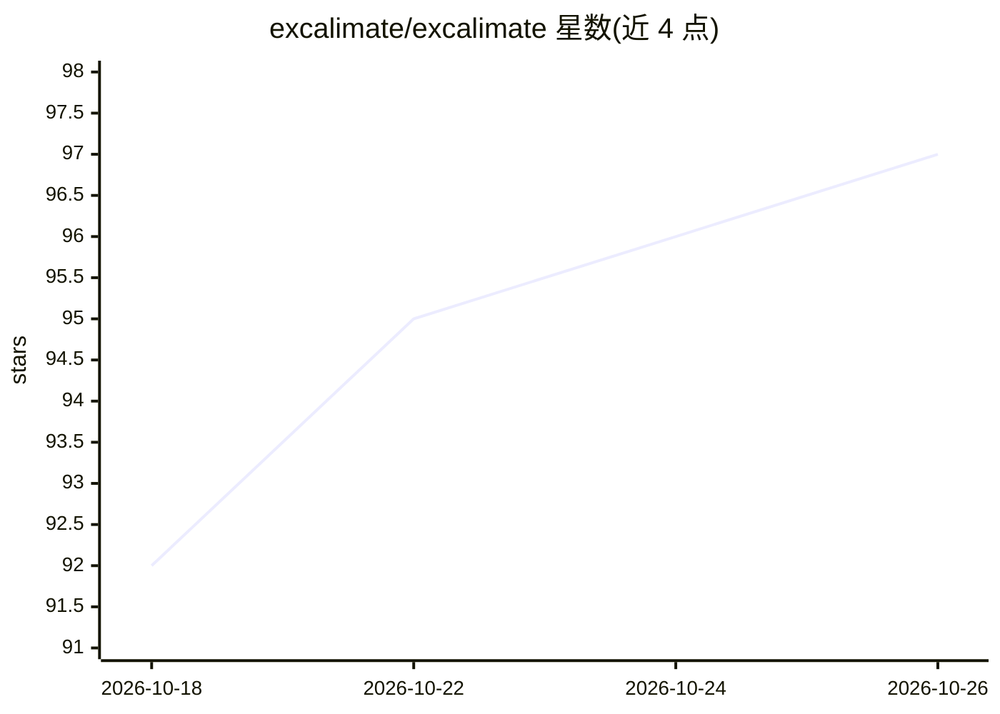

# excalimate/excalimate

⭐ 97 · TypeScript · MIT · 推送 2026-10-25 · [GitHub](https://github.com/excalimate/excalimate) · [官网](https://excalimate.com) · 组织维护

**把 Excalidraw 手绘图变成关键帧动画的 Web 编辑器，附 MCP 服务器**

基于浏览器静态 SPA 的 Excalidraw 动画编辑器：完整绘图编辑、关键帧动画（透明度/位移/缩放/旋转/箭头描画）、相机动画、逐元素时间轴，导出 MP4/WebM/GIF/动画 SVG/Lottie。附带可选 MCP 服务器（35 个工具），供 Copilot、Claude、Cursor 等 AI agent 创建并实时预览动画（SSE live mode）；服务器本身不承载模型。另有端到端加密分享与 16 个 AI 技能文件。README 声明相当部分代码由 AI 生成、清理与修错进行中，需谨慎使用。

## 筛选速览

| 维度 | 判定 | 备注 |
|---|---|---|
| AI 角色 | `ai-enhanced` | 去掉 AI 部分产品仍成立 |
| 许可风险 | `permissive` | MIT |
| 部署形态 | `library` | 以包/库形式分发 |
| 模型依赖 | — | README 未给出锁定关系 |
| 硬件要求 | — | 无带数字的原话,不猜 |
| 安装摩擦 | `low` | 无编译、无系统依赖或容器化 |
| 成熟度 | `idea` | |

## 能力要点

- 关键帧动画与相机 pan/zoom，导出 MP4/WebM/GIF/动画 SVG/Lottie
- MCP 服务器 35 个工具，SSE 实时预览 AI 修改，不承载模型
- AES-256-GCM 客户端加密分享（过期与撤销）
- 16 个 SKILL.md 格式 AI 技能（架构图、流程图、时序图等）

## 适用场景

- 把手绘架构图/流程图做成带逐步揭示效果的教学或演示动画
- 让 AI agent 通过 MCP 代我生成并迭代动画图表，实时看预览
- 导出多种格式用于视频制作或嵌入网页播放

## 场景标签

`图像视频处理` · 领域:感知与多模态

## 证据(README 行号)

> L148: The web app is a **static SPA** — all rendering, animation, and editing happens in the browser. The MCP server is 

## 星数曲线

2026-10-18 92 → 2026-10-26 97（+5）

---
*卡片 v1 · prompt 1.4 · 生成 2026-10-23 · 置信度 high · 依据 README sha `d26334155d7f` · [字段定义](../../DATASET.md)*
