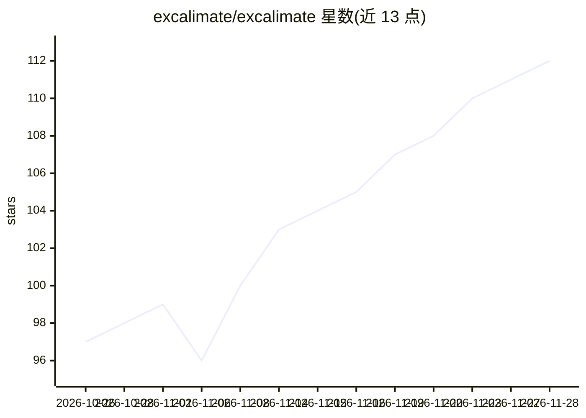

# excalimate/excalimate

⭐ 112 · TypeScript · MIT · 推送 2026-11-14 · [GitHub](https://github.com/excalimate/excalimate) · [官网](https://excalimate.com) · 个人维护

**把 Excalidraw 手绘图变成关键帧动画，并带 AI 驱动创建的 MCP 服务器**

基于 Excalidraw 编辑器的动画工具：绘制图表后可对元素施加透明度、位移、缩放、旋转和箭头绘制动画，通过高级时间轴与相机关键帧编辑，导出 MP4/WebM/GIF/动画 SVG/Lottie。Web 应用为静态 SPA，全部渲染在浏览器完成。附带 MCP 服务器（35 个工具）供 Copilot、Claude、Cursor、Windsurf 等 AI 工具实时创建与动画化图表，并支持 AES-256-GCM 端到端加密分享。README 声明部分代码由 AI 构建，仍在清理修复中。

## 筛选速览

| 维度 | 判定 | 备注 |
|---|---|---|
| AI 角色 | `ai-enhanced` | 去掉 AI 部分产品仍成立 |
| 许可风险 | `permissive` | MIT |
| 部署形态 | `library` | 以包/库形式分发 |
| 模型依赖 | — | README 未给出锁定关系 |
| 硬件要求 | — | 无带数字的原话,不猜 |
| 安装摩擦 | `low` | 无编译、无系统依赖或容器化 |
| 成熟度 | `idea` | |

## 能力要点

- MCP 服务器提供 35 个工具，支持 HTTP 实时预览（SSE）
- 导出 MP4、WebM、GIF、动画 SVG、Lottie、dotLottie
- AES-256-GCM 客户端端到端加密分享，密钥不离开 URL hash
- 附带 16 个 SKILL.md 技能文件，指导 AI agent 生成特定图表类型

## 适用场景

- 把架构图、流程图做成动画演示视频
- 让 AI 工具通过对话生成并动画化 Excalidraw 图表
- 制作带过期与撤销的加密动画分享链接

## 场景标签

`图像视频处理` `代码生成` · 领域:编码与开发

## 证据(README 行号)

> L12: Draw diagrams with the full Excalidraw editor, then animate elements with opacity fades, position slides, scale eff
> L34: - **MCP server** — 35 tools, including all 29 legacy tools and six structured V2 action tools
> L150: The web app is a **static SPA** — all rendering, animation, and editing happens in the browser. The MCP server is 

## 星数曲线

2026-10-26 97 → 2026-11-28 112（+15）

---
*卡片 v1 · prompt 1.4 · 生成 2026-11-28 · 置信度 high · 依据 README sha `d84e43190699` · [字段定义](../../DATASET.md)*
