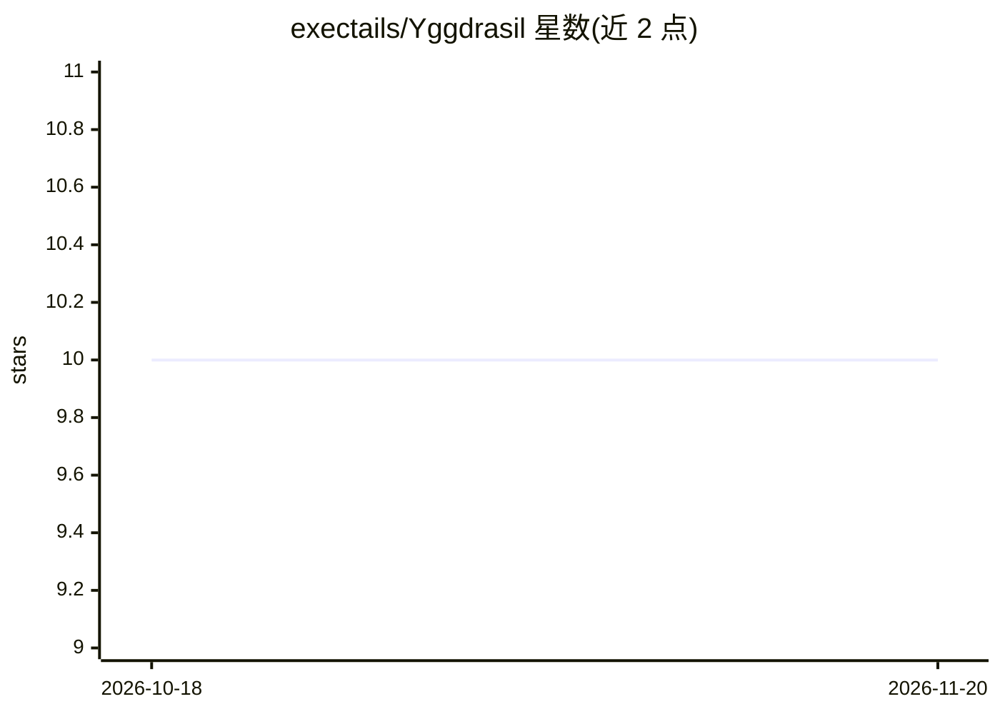

# exectails/Yggdrasil

⭐ 10 · C# · MIT · 推送 2026-10-07 · [GitHub](https://github.com/exectails/Yggdrasil) · 个人维护

**服务器模拟开发的 .NET 基础库（开发中）**

面向服务器模拟（server emulation）开发的 C# 基础类库集合，拆分为多个 NuGet 包分发：Yggdrasil 主包提供 TCP 客户端/服务器、日志、文件读取、哈希等通用工具类；子模块包括 AI 开发基类、文本文件数据库读取、JSON 支持、运行时可编译加载的 .NET 脚本加载器、空间结构（QuadTree/SpatialGrid）、WebSocket 连接扩展与版本枚举处理。项目标注为 Work in progress，README 未提供安装步骤以外的使用说明。

## 筛选速览

| 维度 | 判定 | 备注 |
|---|---|---|
| AI 角色 | `ai-enhanced` | 去掉 AI 部分产品仍成立 |
| 许可风险 | `permissive` | MIT |
| 部署形态 | `None` |  |
| 模型依赖 | — | README 未给出锁定关系 |
| 硬件要求 | — | 无带数字的原话,不猜 |
| 安装摩擦 | `low` | 无编译、无系统依赖或容器化 |
| 成熟度 | `idea` | |

## 能力要点

- 主包提供 TCP 客户端/服务器、日志、哈希等通用工具类
- 多个子库以 NuGet 包（ExecTails.* 前缀）分发
- 包含运行时可编译加载的 .NET 脚本加载器
- 提供 QuadTree、SpatialGrid 等空间结构与 WebSocket 连接扩展

## 适用场景

- 搭建游戏服务器模拟项目所需的网络与工具基础层
- 在 .NET 服务端程序中引入运行时脚本加载能力
- 复用文本文件数据库读取与版本枚举处理组件

## 场景标签

 · 领域:游戏服务器开发/基础库

## 证据(README 行号)

> L3: Base library for server emulation development. *Work in progress.*
> L16: Base classes for AI development.

## 星数曲线

2026-10-18 10 → 2026-11-20 10（+0）

---
*卡片 v1 · prompt 1.4 · 生成 2026-11-19 · 置信度 high · 依据 README sha `014164e4050b` · [字段定义](../../DATASET.md)*
