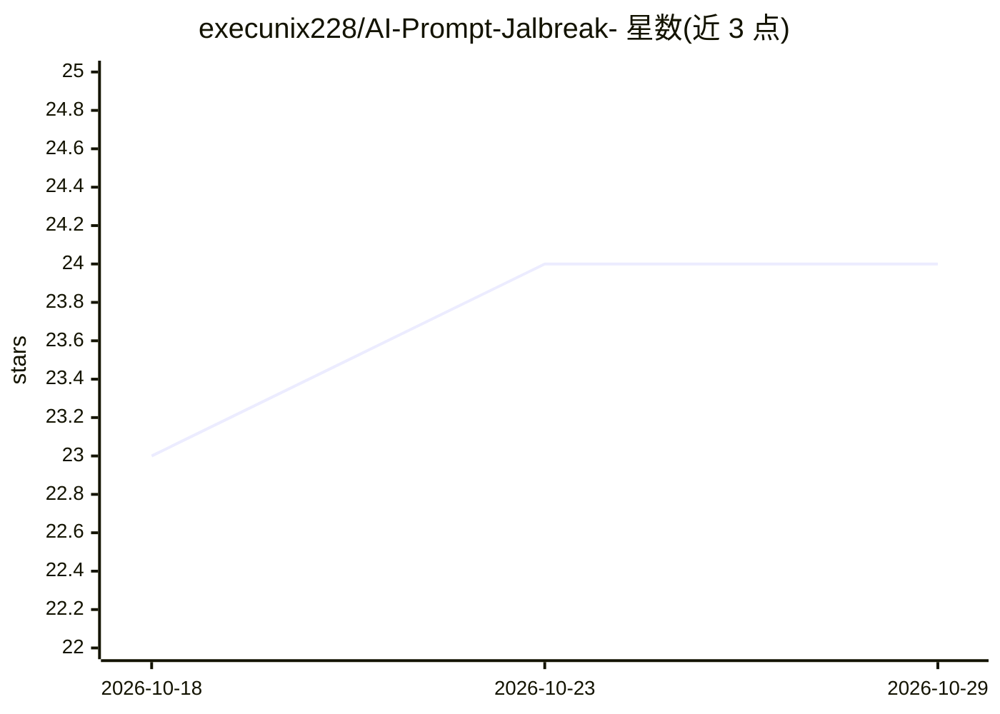

# execunix228/AI-Prompt-Jalbreak-

⭐ 24 · 推送 2026-10-17 · [GitHub](https://github.com/execunix228/AI-Prompt-Jalbreak-) · 个人维护

**面向使用者的 AI jailbreak 提示词合集（1811 条压缩包）**

以 zip 压缩包形式分发的提示词集合，README 称内含 1811 条提示词，并附 CRC32 与 SHA256 校验值供完整性校验。README 声明这些提示词用于测试、绕过或规避各类 AI 模型的安全过滤与伦理限制，作者以公有领域方式发布且不要求署名，同时附有免责声明：不保证提示词在各模型上有效，使用者自行承担账号封禁与法律等后果。合集来自 Telegram 频道 @Bill_Dill0。仓库仅提供下载与校验信息，无安装运行流程。

## 筛选速览

| 维度 | 判定 | 备注 |
|---|---|---|
| AI 角色 | `ai-knowledge` | 知识聚合/清单类 |
| 许可风险 | `none` | — |
| 部署形态 | `None` |  |
| 模型依赖 | — | README 未给出锁定关系 |
| 硬件要求 | — | 无带数字的原话,不猜 |
| 安装摩擦 | `low` | 无编译、无系统依赖或容器化 |
| 成熟度 | — | 结构信号不足 |

## 能力要点

- 以单一 zip 包分发的提示词集合（README 称 1811 条）
- 提供 CRC32 与 SHA256 校验值用于完整性校验
- 作者声明以公有领域发布、不要求署名

## 适用场景

- 获取现成提示词文本进行研究或测试
- 通过校验和核对压缩包完整性

## 场景标签

 · 领域:AI 提示词/知识聚合

## 证据(README 行号)

> L9: - **`TG.BILL_DILL0.zip`** — архив с промтами на данный момент там **1811 промптов.** 🥳
> L25: Данный репозиторий содержит коллекцию промптов для ИИ (включая "jailbreak" промпты, предназначенные для обхода филь

## 星数曲线

2026-10-18 23 → 2026-10-29 24（+1）

---
*卡片 v1 · prompt 1.4 · 生成 2026-10-27 · 置信度 mid · 依据 README sha `4b042ad72376` · [字段定义](../../DATASET.md)*
