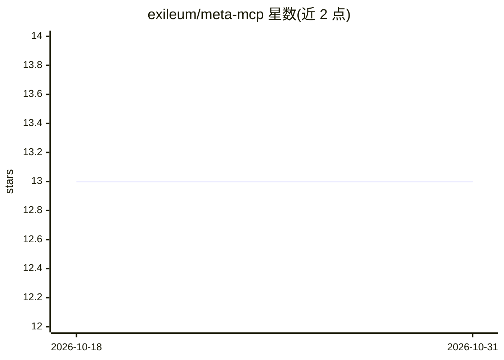

# exileum/meta-mcp

⭐ 13 · TypeScript · MIT · 推送 2026-09-10 · [GitHub](https://github.com/exileum/meta-mcp) · 个人维护

**让 AI 助手通过 MCP 管理 Instagram/Threads 账号的服务器**

MCP 服务器，向 Claude Desktop、Claude Code 等 AI 客户端暴露 58 个工具，经 Meta Graph API 管理 Instagram 与 Threads 账号：发布图文/视频/Reels/轮播/Story、评论管理、私信、话题标签搜索、洞察数据、token 交换与 webhook 订阅。机制上内置速率限制跟踪与自动客户端限流（80%/90% 阈值退避）、瞬时错误指数退避重试、结构化错误响应，支持 stdio 与 Streamable HTTP 两种传输。限制：Instagram 需 Business/Creator 账号，HTTP 对外暴露需自配 TLS/认证反向代理。

## 筛选速览

| 维度 | 判定 | 备注 |
|---|---|---|
| AI 角色 | `ai-ecosystem` | LLM/agent 周边工具 |
| 许可风险 | `permissive` | MIT |
| 部署形态 | `library` | 以包/库形式分发 |
| 模型依赖 | — | README 未给出锁定关系 |
| 硬件要求 | — | 无带数字的原话,不猜 |
| 安装摩擦 | `low` | 无编译、无系统依赖或容器化 |
| 成熟度 | — | 结构信号不足 |

## 能力要点

- 58 个工具覆盖 Instagram(33)/Threads(19)/Meta 平台(6)
- 速率限制跟踪与 80%/90% 阈值自动客户端限流
- 瞬时 API 失败自动指数退避重试（可调 maxRetries）
- 支持 stdio 与 Streamable HTTP 传输（多会话、默认仅回环绑定）

## 适用场景

- 让 Claude 类客户端直接代发 Instagram/Threads 内容
- 通过对话处理评论、私信与协作邀请
- 查询账号与媒体洞察数据、生成分析报告
- 管理 Meta token 交换/刷新与 webhook 订阅

## 场景标签

`数据分析` · 领域:效率与自动化

## 证据(README 行号)

> L5: meta-mcp MCP server
> L63: By default the server speaks MCP over **stdio** — the right choice for local clients (Claude Desktop, Claude Code, 
> L83: - **58 tools** across Instagram (33), Threads (19), and Meta platform (6)

## 星数曲线

2026-10-18 13 → 2026-10-31 13（+0）

---
*卡片 v1 · prompt 1.4 · 生成 2026-10-31 · 置信度 high · 依据 README sha `a69a726cf96d` · [字段定义](../../DATASET.md)*
