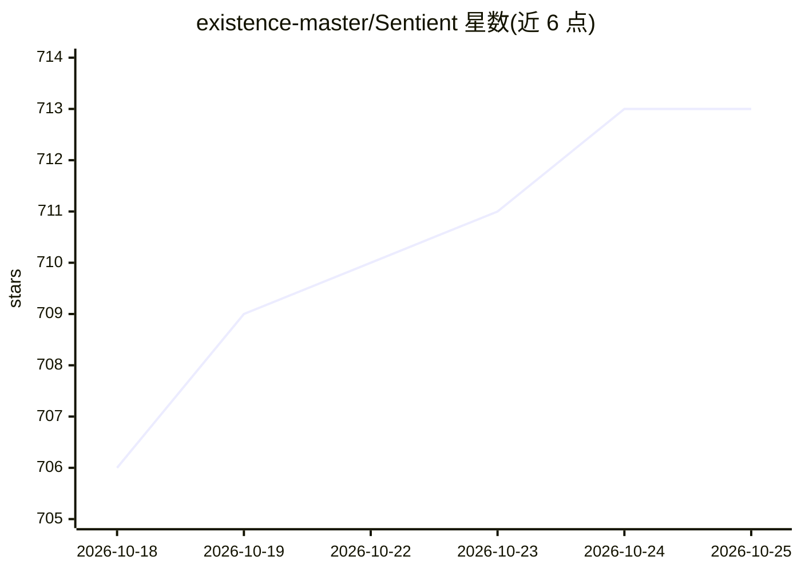

# existence-master/Sentient

⭐ 715 · Python · NOASSERTION · 推送 2026-10-25 · [GitHub](https://github.com/existence-master/Sentient) · [官网](https://existence.technology/sentient) · 组织维护

**本地运行的个人 AI 助理：长任务、记忆、语音与设备配对**

运行在用户自己电脑上的个人助理应用：单个 agent 循环驱动聊天、长时任务（一次性/定时/事件触发，可断点重试）、夜间记忆整理（合并重复、解决矛盾）、唤醒词语音交互（本地语音识别）、手机与智能眼镜配对（开放协议，含参考眼镜固件）、技能学习与 diff 审批。模型可选本地（经 Ollama）或云端（Anthropic/OpenAI/Gemini key），无账号。数据存于单一 SQLite 文件。v3 处于 alpha，Windows 安装包需自行构建，也可从源码运行。

## 筛选速览

| 维度 | 判定 | 备注 |
|---|---|---|
| AI 角色 | `ai-native` | 本体是模型或模型工具 |
| 许可风险 | `none` | NOASSERTION |
| 部署形态 | `desktop` | 安装包/桌面程序 |
| 模型依赖 | local-ok | 支持本地模型 |
| 硬件要求 | — | 无带数字的原话,不猜 |
| 安装摩擦 | `low` | 无编译、无系统依赖或容器化 |
| 成熟度 | `idea` | |

## 能力要点

- 长时任务：一次性/定时/事件触发，保留实时日志与报告，失败可从断点重试
- 夜间记忆整理与偏好画像，用户可确认或纠正
- 开放设备协议：六位码配对手机/智能眼镜，含参考眼镜固件
- 任何模型：本地 Ollama 与自有云 API key 可混用，按用途分别选模型

## 适用场景

- 让 AI 在后台跑长任务并定时汇报，离开电脑也能继续
- 用语音唤醒词与本地模型对话，数据不出机器
- 把手机或智能眼镜配对为随身 AI 入口
- 让助理接入 Gmail/日历/GitHub 等服务并主动提醒

## 场景标签

`AI 助手` `语音 Agent` · 领域:对话与助手

## 证据(README 行号)

> L3:  Your personal assistant, running on your own computer.
> L4:  It runs long tasks for you, remembers what matters, notices things before you ask, and talks with you by voice.
> L32:  Describe a job in plain words. Sentient plans it, asks you once, then runs it now, on a schedule, when an email

## 星数曲线

2026-10-18 706 → 2026-10-25 713（+7）

---
*卡片 v1 · prompt 1.4 · 生成 2026-10-21 · 置信度 high · 依据 README sha `3d84dfd49a4a` · [字段定义](../../DATASET.md)*
