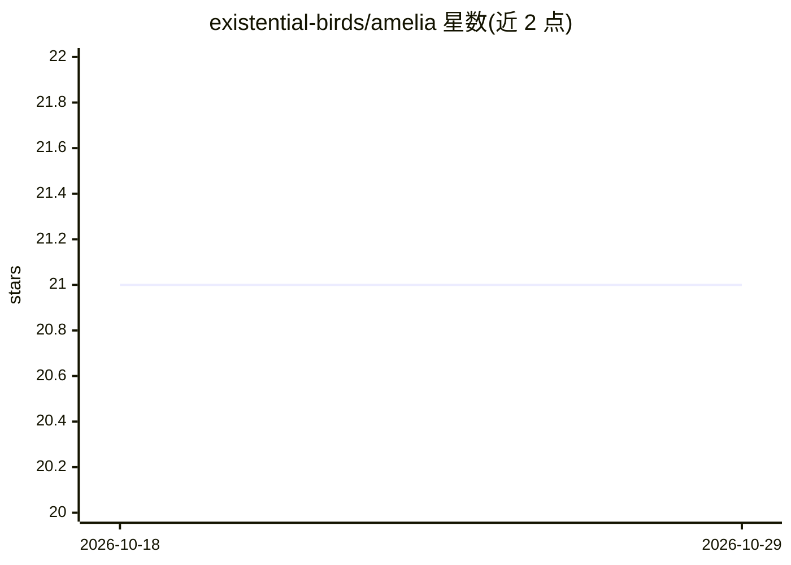

# existential-birds/amelia

⭐ 21 · Python · Apache-2.0 · 推送 2026-09-09 · [GitHub](https://github.com/existential-birds/amelia) · [官网](https://existentialbirds.com/projects/amelia) · 组织维护

**软件开发多智能体编排器：规划-开发-审查流程带人工审批**

面向开发者的多智能体编排 CLI 工具：任务经 Architect→Developer→Reviewer 专职 agent 在 LangGraph 状态机上执行，审批门由人控制，提供 localhost:8420 仪表盘、工作流队列与 GitHub/Jira issue 集成。LLM 接入支持 OpenRouter API 及 Claude CLI、Codex CLI 驱动，配置存储于 PostgreSQL 且跨项目共享。README 顶部声明该仓库不再积极维护，建议迁移到 Hermes Agent。

## 筛选速览

| 维度 | 判定 | 备注 |
|---|---|---|
| AI 角色 | `ai-ecosystem` | LLM/agent 周边工具 |
| 许可风险 | `permissive` | Apache-2.0 |
| 部署形态 | `None` |  |
| 模型依赖 | locked-api |  |
| 硬件要求 | — | 无带数字的原话,不猜 |
| 安装摩擦 | `low` | 无编译、无系统依赖或容器化 |
| 成熟度 | — | 结构信号不足 |

## 能力要点

- Architect→Developer→Reviewer 三段式 agent 流程，LangGraph 状态机驱动
- 人工审批门 + 仪表盘（端口 8420）
- GitHub/Jira issue 驱动工作流与队列执行
- 多种 LLM 驱动：OpenRouter API、Claude CLI、Codex CLI

## 适用场景

- 从 GitHub/Jira issue 启动自动化开发工作流并人工把关计划
- 审查未提交的代码变更
- 按 agent 角色配置不同模型路由

## 场景标签

`多智能体` `代码审查` · 领域:Agent 开发

## 证据(README 行号)

> L10: Amelia is multi-agent orchestration for software development with human-in-the-loop approval gates and end-to-end o
> L88: Amelia runs your task through specialized agents (Architect → Developer → Reviewer) on a LangGraph state machine, p

## 星数曲线

2026-10-18 21 → 2026-10-29 21（+0）

---
*卡片 v1 · prompt 1.4 · 生成 2026-10-28 · 置信度 high · 依据 README sha `599aece8f307` · [字段定义](../../DATASET.md)*
