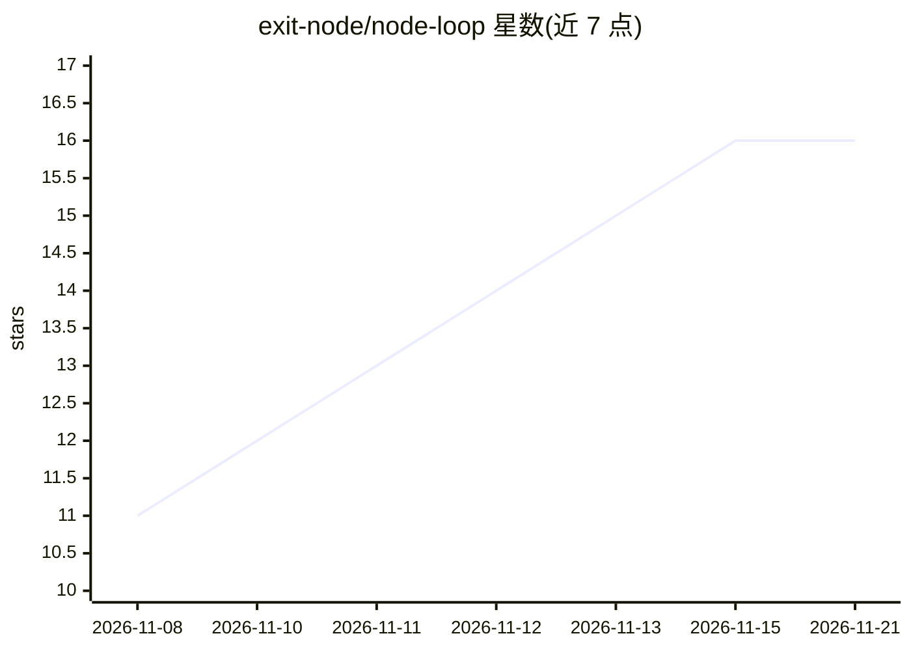

# exit-node/node-loop

⭐ 16 · TypeScript · MIT · 推送 2026-11-04 · [GitHub](https://github.com/exit-node/node-loop) · 组织维护

**omp 终端编码代理的多智能体编码循环插件**

omp（终端编码代理）的插件：给定目标后运行多智能体循环——scouts 映射仓库，planner 将工作切分为小的 plan nodes，每个节点在独立 checkout 中由单独 implementer 构建，并由不同模型 review 直至通过；全部合并后由三模型 council 盲审整条分支。支持跨 provider 审查、fence 文件边界、parking.md 收集计划外想法。要求 omp 18.11.1+、git、bash（macOS/Linux，不支持 Windows）。通过 omp marketplace 安装。

## 筛选速览

| 维度 | 判定 | 备注 |
|---|---|---|
| AI 角色 | `ai-ecosystem` | LLM/agent 周边工具 |
| 许可风险 | `permissive` | MIT |
| 部署形态 | `None` |  |
| 模型依赖 | — | README 未给出锁定关系 |
| 硬件要求 | — | 无带数字的原话,不猜 |
| 安装摩擦 | `low` | 无编译、无系统依赖或容器化 |
| 成熟度 | — | 结构信号不足 |

## 能力要点

- scouts→planner→隔离 implementer→跨模型 review→三模型 council 的完整循环
- plan node 各自在独立 checkout/分支构建，fence 之外的改动自动失败
- 设置命令为 7 种模型角色（node-* 与 council-seat-*）分配模型，支持跨 provider 审查
- 运行状态存于 ~/.omp/node-loop/，不推送任何内容

## 适用场景

- 让多个模型分工规划、实现并交叉审查代码改动
- 在已有 git 仓库上自动完成一个开发目标并得到 council 终审
- 希望审查者与实现者来自不同 provider 以降低同源偏差

## 场景标签

`多智能体` `编码 Agent` `代码审查` · 领域:Agent 开发

## 证据(README 行号)

> L3: node-loop is a plugin for omp, a terminal coding agent.
> L6: Each plan node is built in its own isolated checkout and reviewed by a different model until the review passes.
> L91: - `modelRoles`: one entry for each of the seven node-loop roles (`node-*` and `council-seat-*`).

## 星数曲线

2026-11-08 11 → 2026-11-21 16（+5）

---
*卡片 v1 · prompt 1.4 · 生成 2026-11-18 · 置信度 high · 依据 README sha `718e146b63f3` · [字段定义](../../DATASET.md)*
