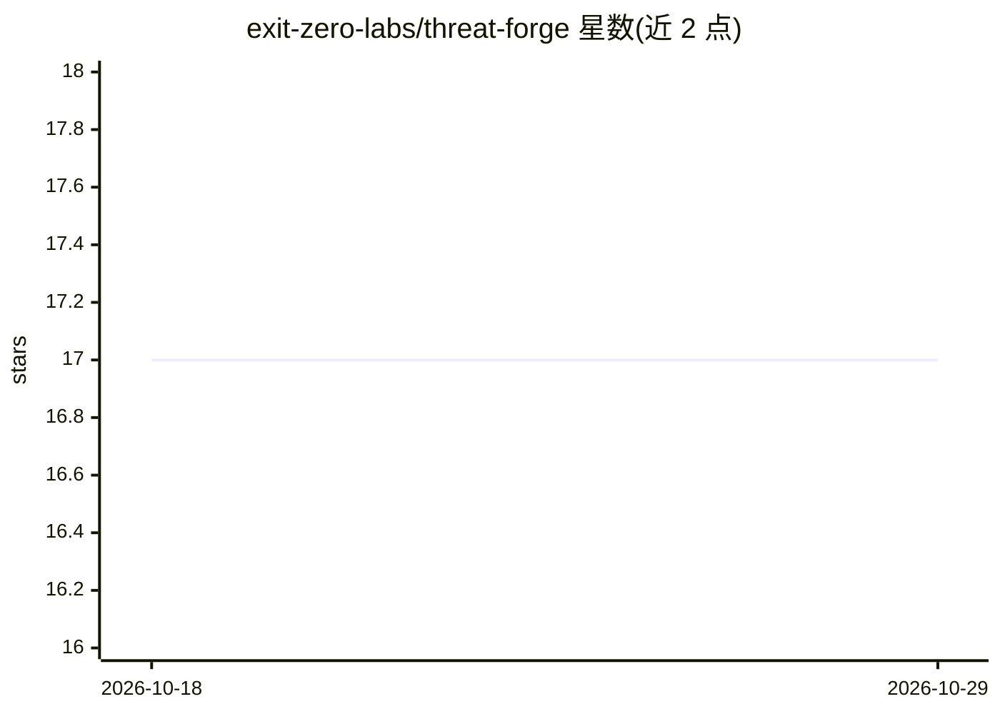

# exit-zero-labs/threat-forge

⭐ 17 · TypeScript · Apache-2.0 · 推送 2026-10-22 · [GitHub](https://github.com/exit-zero-labs/threat-forge) · [官网](https://www.threatforge.dev) · 组织维护

**跨平台桌面威胁建模工具，AI 辅助 STRIDE 分析，产出 git 友好 YAML**

基于 Tauri v2 与 React 的跨平台（macOS/Windows/Linux）威胁建模桌面应用：拖拽画布绘制数据流图，内置规则引擎按 STRIDE 方法离线生成威胁，另支持接入 Claude 或 GPT 进行对话式威胁建议与缓解方案（自带 API key，AES-256-GCM 加密存储）。模型保存为单一人类可读、git-diffable 的 .thf YAML 文件，可导入 Microsoft TMT 的 .tm7 文件，附 6 套预置模板。从源码构建运行，需 Node.js 22+、Rust 与 Tauri v2 前置依赖。

## 筛选速览

| 维度 | 判定 | 备注 |
|---|---|---|
| AI 角色 | `ai-enhanced` | 去掉 AI 部分产品仍成立 |
| 许可风险 | `permissive` | Apache-2.0 |
| 部署形态 | `library` | 以包/库形式分发 |
| 模型依赖 | locked-api |  |
| 硬件要求 | — | 无带数字的原话,不猜 |
| 安装摩擦 | `low` | 无编译、无系统依赖或容器化 |
| 成熟度 | — | 结构信号不足 |

## 能力要点

- 拖拽画布数据流图 + STRIDE 规则引擎，离线生成威胁
- AI 辅助分析：接入 Claude/GPT 建议威胁与缓解，一键采纳
- .thf 单文件 YAML 格式，git-diffable，可导入 .tm7
- 6 套预置模板与命令面板、键盘优先工作流

## 适用场景

- 安全团队用画布绘制架构并生成 STRIDE 威胁清单
- 把 Microsoft TMT 的 .tm7 模型迁移到跨平台工具
- 在代码评审流程中用 git diff 审阅威胁模型变更
- 让 AI 基于完整架构建议威胁与缓解措施

## 场景标签

`网络安全` · 领域:学习与行业

## 证据(README 行号)

> L18: ThreatForge is a cross-platform desktop app for threat modeling. It produces human-readable, git-diffable YAML file
> L40: Chat with Claude or GPT about your threat model. The AI sees your full architecture — elements, data flows, trust b

## 星数曲线

2026-10-18 17 → 2026-10-29 17（+0）

---
*卡片 v1 · prompt 1.4 · 生成 2026-10-29 · 置信度 mid · 依据 README sha `cd6426a5f631` · [字段定义](../../DATASET.md)*
