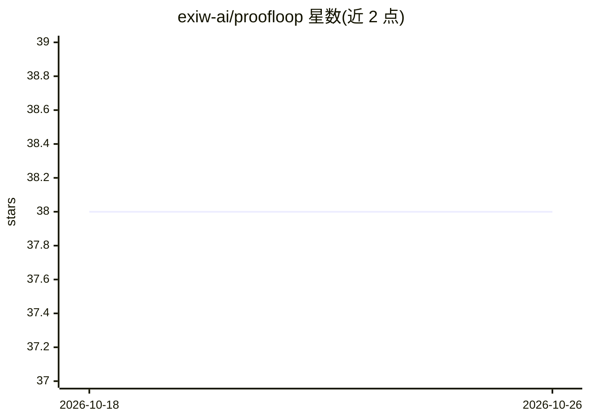

# exiw-ai/proofloop

⭐ 38 · Python · Apache-2.0 · 推送 2026-04-18 · [GitHub](https://github.com/exiw-ai/proofloop) · 组织维护

**编排编码 agent 自主运行至验证完成的 CLI 编排器**

Proofloop 是一个 Python 3.12+ 的 AI agent 编排器，用于长时间编码任务：规划阶段 agent 提出假设、风险、分步计划与可验证的完成条件，用户审批后 agent 自主执行，通过实际运行命令（pytest、mypy、make build 等）而非 agent 自评来独立验证完成条件。内置监督机制检测循环、停滞与回归并决定重试/回滚/停止，支持 50+ 迭代、跨多仓库协作。底层编排 OpenCode、Codex 或 Claude Code，通过 curl 安装脚本与 CLI（proofloop run）使用。

## 筛选速览

| 维度 | 判定 | 备注 |
|---|---|---|
| AI 角色 | `ai-ecosystem` | LLM/agent 周边工具 |
| 许可风险 | `permissive` | Apache-2.0 |
| 部署形态 | `library` | 以包/库形式分发 |
| 模型依赖 | locked-api |  |
| 硬件要求 | — | 无带数字的原话,不猜 |
| 安装摩擦 | `low` | 无编译、无系统依赖或容器化 |
| 成熟度 | — | 结构信号不足 |

## 能力要点

- 完成条件由实际命令运行验证，非 agent 自评
- 监督机制检测循环/停滞/回归，决定重试或回滚
- 支持 OpenCode / Codex / Claude Code 三种 provider
- 多仓库变更协调与任务管理（list/status/resume）

## 适用场景

- 睡前启动数小时的迁移或重构任务，醒来查看验证结果
- 以测试通过、构建成功等条件定义任务完成标准
- 跨多个仓库协调一致的后端/前端变更

## 场景标签

`编码 Agent` `Agent 框架` · 领域:Agent 开发

## 证据(README 行号)

> L14: Proofloop is an AI agent orchestrator that solves the main problem with coding agents on real-world tasks: **long t
> L55: Proofloop orchestrates existing AI agents — install whichever you prefer:
> L104: - **Multi-provider** — Uses OpenCode, Codex, or Claude Code under the hood

## 星数曲线

2026-10-18 38 → 2026-10-26 38（+0）

---
*卡片 v1 · prompt 1.4 · 生成 2026-10-25 · 置信度 mid · 依据 README sha `0f310a6a2c8d` · [字段定义](../../DATASET.md)*
