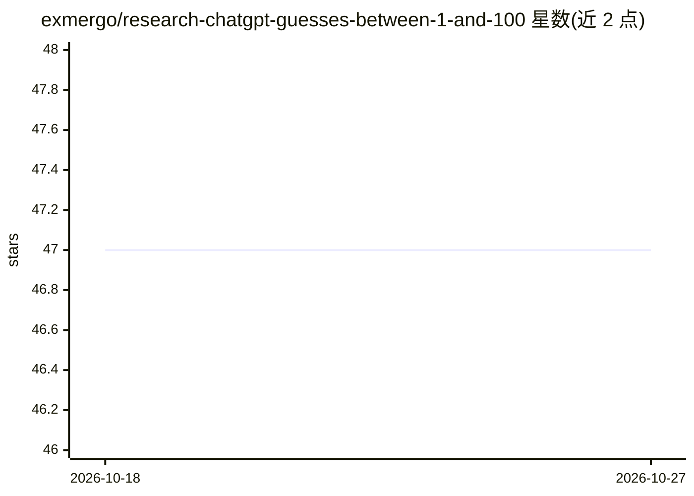

# exmergo/research-chatgpt-guesses-between-1-and-100

⭐ 47 · Python · MIT · 推送 2026-05-25 · [GitHub](https://github.com/exmergo/research-chatgpt-guesses-between-1-and-100) · [官网](https://viz.exmergo.com/share/eea2a7b6-82d4-4333-8853-e909d9dabd49) · 组织维护

**测量 gpt-4.1 随机选数分布偏差的研究项目（含数据集）**

Exmergo 发布的开放研究项目：通过 OpenAI Responses API 以固定 system prompt、temperature=1.0 向 gpt-4.1 发起 10,000 次独立调用，要求其输出 1–100 之间的整数，随后以均匀分布为基线做卡方拟合检验，发现分布集中于 37/42/73、避开 10 的倍数等模式。提供四阶段流水线（collect→clean→transform→stats），原始数据集已提交到仓库，可无 API key 复现全部分析；重新采集约花费 2 美元。局限性明确声明仅覆盖单一模型与固定提示词。

## 筛选速览

| 维度 | 判定 | 备注 |
|---|---|---|
| AI 角色 | `ai-knowledge` | 知识聚合/清单类 |
| 许可风险 | `permissive` | MIT |
| 部署形态 | `None` |  |
| 模型依赖 | — | README 未给出锁定关系 |
| 硬件要求 | — | 无带数字的原话,不猜 |
| 安装摩擦 | `low` | 无编译、无系统依赖或容器化 |
| 成熟度 | — | 结构信号不足 |

## 能力要点

- N=10,000 次独立调用，χ² 拟合检验对比均匀分布
- 原始 CSV 数据集随仓库提交，可免费复现分析
- 四阶段流水线，各阶段可独立重跑
- 模型字符串与采样参数记录在每行数据与元数据中

## 适用场景

- 复现或查阅 LLM 随机数偏差的实验数据与结论
- 作为 LLM 输出分布研究的参考案例
- 基于已提交数据集做二次统计分析

## 场景标签

 · 领域:LLM 行为研究

## 证据(README 行号)

> L11: **This project asks `gpt-4.1` the same question 10,000 times** and
> L133: The raw dataset is committed to this repo, so you can reproduce the entire

## 星数曲线

2026-10-18 47 → 2026-10-27 47（+0）

---
*卡片 v1 · prompt 1.4 · 生成 2026-10-25 · 置信度 high · 依据 README sha `23605fda87e4` · [字段定义](../../DATASET.md)*
