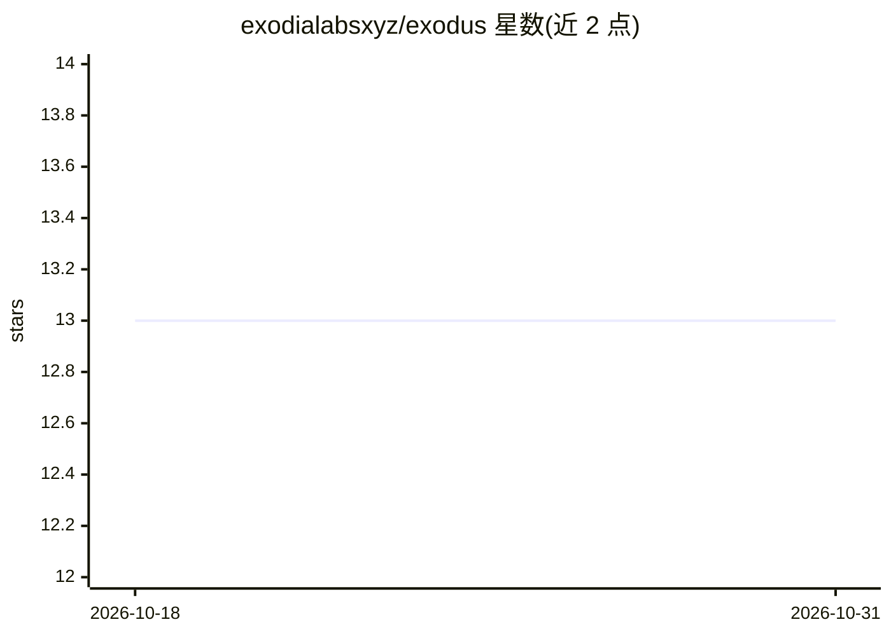

# exodialabsxyz/exodus

⭐ 13 · Python · MIT · 推送 2026-02-23 · [GitHub](https://github.com/exodialabsxyz/exodus) · 组织维护

**面向渗透测试的轻量模块化多 agent 网络安全框架**

开源 Python 网络安全框架，面向渗透测试人员与安全分析师：以 TOML 配置定义 agent，支持多 agent 编队与动态 handoff、插件扩展（Python entry points 自动发现）、上下文自动摘要等机制。提供交互式（Human-in-the-Loop）与全自动两种执行引擎，全自动模式含动态规划、反思、重规划、检查点续跑与人工升级。模型接入经 litellm 支持 DeepSeek、Ollama、Google、OpenAI 等；工具可在 Docker 隔离容器中执行。安装提供一键脚本与 pip -e 两种途径，需 Python 3.11+。

## 筛选速览

| 维度 | 判定 | 备注 |
|---|---|---|
| AI 角色 | `ai-ecosystem` | LLM/agent 周边工具 |
| 许可风险 | `permissive` | MIT |
| 部署形态 | `self-host` | docker 或自建部署 |
| 模型依赖 | local-ok | 支持本地模型 |
| 硬件要求 | — | 无带数字的原话,不猜 |
| 安装摩擦 | `low` | 无编译、无系统依赖或容器化 |
| 成熟度 | — | 结构信号不足 |

## 能力要点

- TOML 配置定义 agent，支持多 agent 编队与动态 handoff
- 全自动模式含动态规划、反思/重规划、检查点续跑与人工升级
- 插件经 Python entry points 自动发现，可打包为 PyPI 分发
- 上下文达 90% 阈值时自动摘要压缩，支持长任务

## 适用场景

- 以对话方式指挥 agent 执行端口扫描、目录爆破等渗透测试操作
- 无人值守的自动化侦察与漏洞发现（CI/CD、bug bounty）
- 编写并共享自定义安全工具插件与专项 agent

## 场景标签

`网络安全` `多智能体` `Agent 框架` · 领域:Agent 开发

## 证据(README 行号)

> L3: EXODUS is a lightweight, modular, open-source cybersecurity framework. Create and share your agents, add capabilitie
> L10: + Use the model you want: support for DeepSeek, Ollama, Google, OpenAI, and more.

## 星数曲线

2026-10-18 13 → 2026-10-31 13（+0）

---
*卡片 v1 · prompt 1.4 · 生成 2026-10-31 · 置信度 mid · 依据 README sha `5a7ed4716b49` · [字段定义](../../DATASET.md)*
