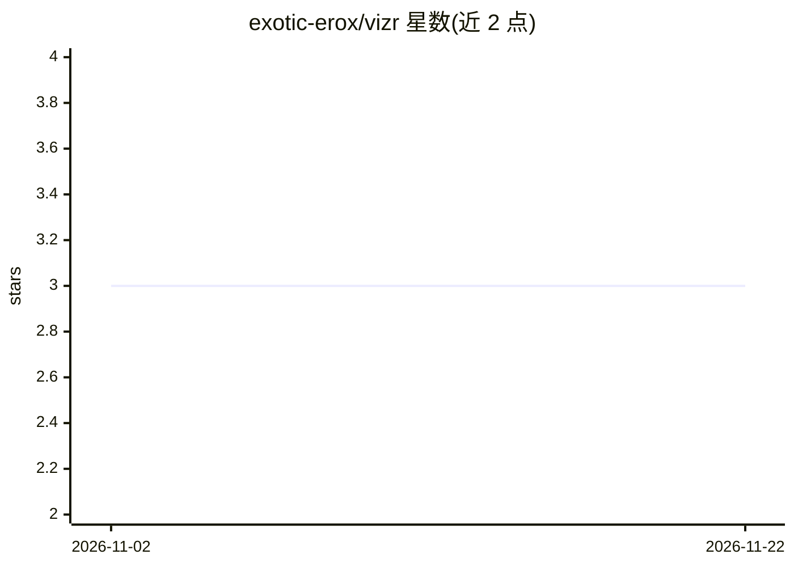

# exotic-erox/vizr

⭐ 3 · Python · MIT · 推送 2026-10-26 · [GitHub](https://github.com/exotic-erox/vizr) · [官网](https://pypi.org/project/vizr/) · 个人维护

**终端盲文字符音频粒子可视化 CLI 工具**

在终端中运行的音频反应式粒子可视化工具：捕获系统音频或播放器音频，将频谱转为数千个粒子，以盲文字符（每格 2×4 点阵）渲染。提供 24 种可视化模式、模式间形变过渡、预设配置；通过 playerctl 轮询 MPRIS 获取正在播放的曲目信息并支持键盘/点击控制播放。音频捕获依次尝试 PulseAudio/PipeWire 的 parec 与 sounddevice，均失败时使用内置演示信号。通过 pipx 或 nix 安装，仅支持 Linux 与 macOS。

## 筛选速览

| 维度 | 判定 | 备注 |
|---|---|---|
| AI 角色 | `ai-enhanced` | 去掉 AI 部分产品仍成立 |
| 许可风险 | `permissive` | MIT |
| 部署形态 | `library` | 以包/库形式分发 |
| 模型依赖 | — | README 未给出锁定关系 |
| 硬件要求 | — | 无带数字的原话,不猜 |
| 安装摩擦 | `low` | 无编译、无系统依赖或容器化 |
| 成熟度 | — | 结构信号不足 |

## 能力要点

- 24 种音频反应式可视化模式与模式形变过渡
- 盲文字符渲染，每字符格 2×4 子像素分辨率
- 通过 MPRIS/playerctl 获取曲目信息并控制播放
- parec/sounddevice 多级音频捕获，失败时回退内置演示信号

## 适用场景

- 在终端里听音乐时显示音频可视化效果
- 通过键盘控制 Spotify 等 MPRIS 播放器的播放
- 在 SSH/远程终端会话中运行可视化

## 场景标签

 · 领域:桌面/终端工具

## 证据(README 行号)

> L3: Braille particle visualizer for the terminal. Plays nice with Spotify, any MPRIS player, or just your system audio.
> L22: Captures your audio, turns the spectrum into a few thousand particles, and draws them as braille dots — so you get 

## 星数曲线

2026-11-02 3 → 2026-11-22 3（+0）

---
*卡片 v1 · prompt 1.4 · 生成 2026-11-22 · 置信度 high · 依据 README sha `eb8ebce33b41` · [字段定义](../../DATASET.md)*
