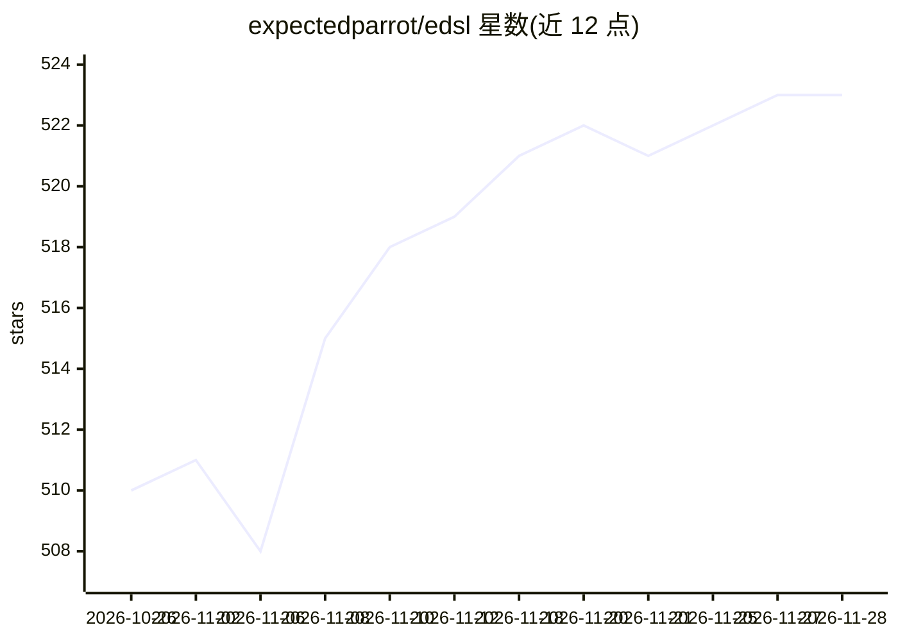

# expectedparrot/edsl

⭐ 523 · Python · MIT · 推送 2026-11-27 · [GitHub](https://github.com/expectedparrot/edsl) · [官网](https://docs.expectedparrot.com) · 组织维护

**面向科研者的 AI 问卷调查/实验 DSL 框架**

EDSL 是一个 Python 领域特定语言库，用于设计、运行和分析由 AI agent 与大语言模型回答的问卷与实验，应用于计算社会科学、市场研究与数据标注。核心机制包括声明式问题类型、参数化场景（CSV/PDF/PNG 导入）、带特质的 agent 人设构建、多模型并行运行、管道与跳题逻辑、自动缓存 API 调用与远程结果存储以复现输出。运行需 Python 3.10-3.13 及 LLM API key（自有 key 或 Expected Parrot 统一 key）。

## 筛选速览

| 维度 | 判定 | 备注 |
|---|---|---|
| AI 角色 | `ai-ecosystem` | LLM/agent 周边工具 |
| 许可风险 | `permissive` | MIT |
| 部署形态 | `library` | 以包/库形式分发 |
| 模型依赖 | — | README 未给出锁定关系 |
| 硬件要求 | — | 无带数字的原话,不猜 |
| 安装摩擦 | `low` | 无编译、无系统依赖或容器化 |
| 成熟度 | — | 结构信号不足 |

## 能力要点

- 声明式问卷设计与 skip/piping 逻辑的数据标注流
- 构建带特质参数的 agent 人设列表生成多样化回答
- 一次运行多个 LLM 并在统一界面对比回答
- API 调用自动缓存，远程结果可无成本复现

## 适用场景

- 用大量 AI agent 模拟社会科学问卷预测试
- 用问卷形式对数据集做批量标注
- 同时对比多个 LLM 在同一组问题上的回答
- 在 Coop 平台分享可复现的研究工作流

## 场景标签

`科研工具` · 领域:学习与行业

## 证据(README 行号)

> L5: EDSL makes it easy to conduct computational social science and market research with AI. Use it to design and run sur
> L24: 1. Run `pip install edsl` to install the package. See the installation guide.
> L105: ml = ModelList(Model(m) for m in ["gpt-4o", "gemini-1.5-flash"])

## 星数曲线

2026-10-26 510 → 2026-11-28 523（+13）

---
*卡片 v1 · prompt 1.4 · 生成 2026-11-26 · 置信度 high · 依据 README sha `b129c0320ae6` · [字段定义](../../DATASET.md)*
