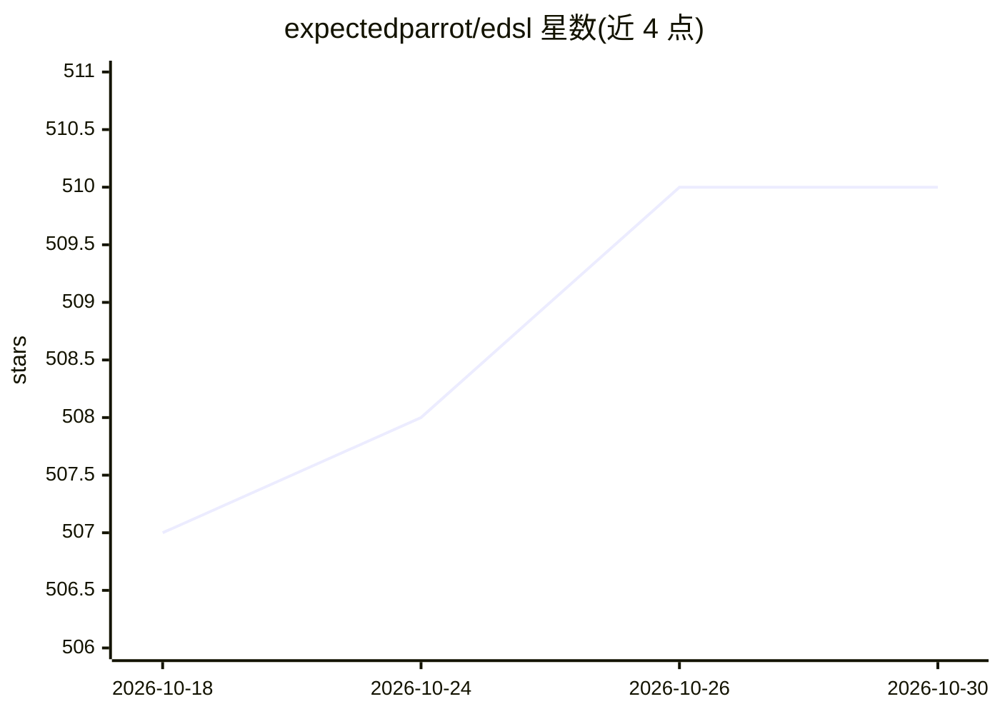

# expectedparrot/edsl

⭐ 510 · Python · MIT · 推送 2026-10-29 · [GitHub](https://github.com/expectedparrot/edsl) · [官网](https://docs.expectedparrot.com) · 组织维护

**用 AI agent 和 LLM 设计、运行和分析调查与实验的 DSL 框架**

Expected Parrot 的 Python 领域特定语言（EDSL），面向计算社会科学与市场研究：以声明式题型设计问卷与实验，构造带人格特征的 AI agent 作答，支持多模型同时运行与对比、参数化提示词（从 CSV/PDF/PNG 等导入数据）、piping 与跳过逻辑。API 调用自动缓存，可在本地或 Expected Parrot 服务器运行，结果存为可复现数据集并内置分析工具。需要 Python 3.9-3.13 与 LLM API key（自有 key 或 Expected Parrot key）。README 提示 AI 模拟回答反映统计模式而非真实群体意见，建议配合人类数据验证。

## 筛选速览

| 维度 | 判定 | 备注 |
|---|---|---|
| AI 角色 | `ai-ecosystem` | LLM/agent 周边工具 |
| 许可风险 | `permissive` | MIT |
| 部署形态 | `library` | 以包/库形式分发 |
| 模型依赖 | — | README 未给出锁定关系 |
| 硬件要求 | — | 无带数字的原话,不猜 |
| 安装摩擦 | `low` | 无编译、无系统依赖或容器化 |
| 成熟度 | — | 结构信号不足 |

## 能力要点

- 声明式题型设计，无需 JSON schema 即可得到结构化结果
- 构造带 persona 的 AI agent 模拟多样化受访者
- 多模型同时运行并对比回答（ModelList）
- API 调用自动缓存与远程结果存储，支持零成本复现

## 适用场景

- 用大量 AI agent 预测和试测问卷，再上真人验证
- 用多个 LLM 同时作答同一调查并对比结果
- 构建带跳过逻辑的复杂数据标注流程

## 场景标签

`科研工具` · 领域:学习与行业

## 证据(README 行号)

> L5: EDSL makes it easy to conduct computational social science and market research with AI. Use it to design and run sur
> L86: **Simplified access to LLMs**:

## 星数曲线

2026-10-18 507 → 2026-10-30 510（+3）

---
*卡片 v1 · prompt 1.4 · 生成 2026-10-21 · 置信度 high · 依据 README sha `e37e34cd0d50` · [字段定义](../../DATASET.md)*
