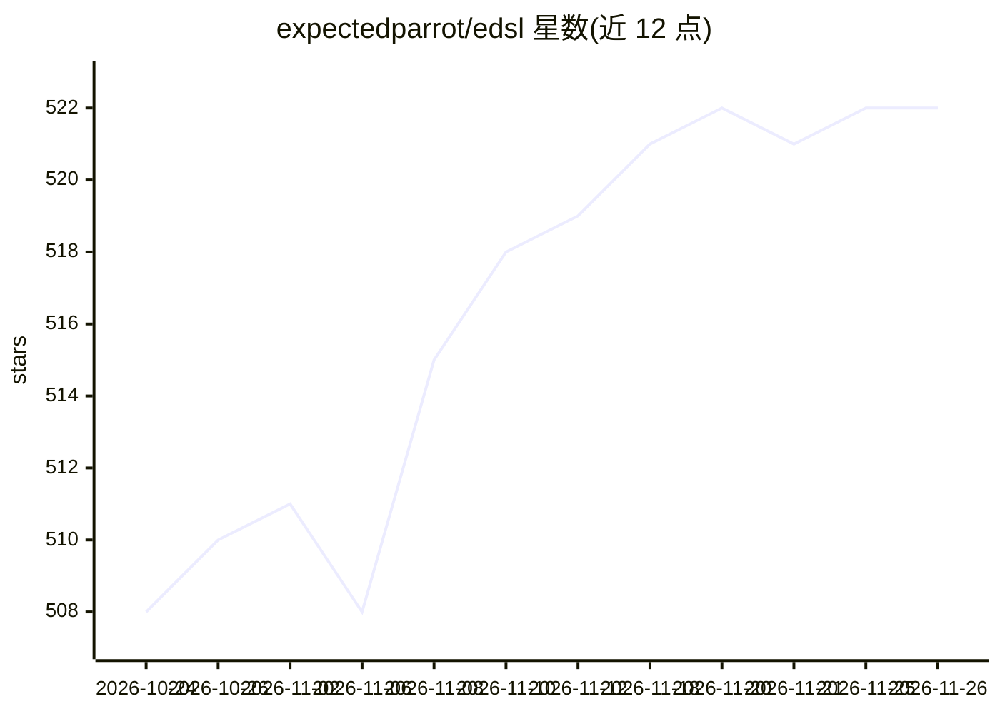

# expectedparrot/edsl

⭐ 522 · Python · MIT · 推送 2026-11-25 · [GitHub](https://github.com/expectedparrot/edsl) · [官网](https://docs.expectedparrot.com) · 组织维护

**用 LLM 模拟受访者运行社科与市场调研问卷的 Python 框架**

EDSL 是 Expected Parrot 维护的领域专用语言（DSL）Python 包，用于设计并以多个 AI agent 与 LLM 批量运行问卷和实验，输出结构化数据集，内置分析、可视化与协作方法。关键机制：声明式题型、scenario 参数化提示词（支持 CSV/PDF/PNG 等来源）、agent 人设构建、答案 piping 与 skip-logic、API 调用自动缓存与远程通用缓存以保证结果可复现。运行需 Python 3.10-3.13 与 LLM API 密钥，可本地运行或在 Expected Parrot 服务器运行，并提醒模拟回答是统计模式而非真实人群观点，需人类数据验证。

## 筛选速览

| 维度 | 判定 | 备注 |
|---|---|---|
| AI 角色 | `ai-native` | 本体是模型或模型工具 |
| 许可风险 | `permissive` | MIT |
| 部署形态 | `library` | 以包/库形式分发 |
| 模型依赖 | — | README 未给出锁定关系 |
| 硬件要求 | — | 无带数字的原话,不猜 |
| 安装摩擦 | `low` | 无编译、无系统依赖或容器化 |
| 成熟度 | — | 结构信号不足 |

## 能力要点

- 声明式问卷设计与 skip/piping 逻辑的数据标注流
- AgentList 构建多个人设 agent 批量作答
- API 调用自动缓存与远程通用缓存，共享代码即可零成本复现结果
- 多模型并行运行并对比回答（示例中 gpt-4o 与 gemini-1.5-flash）

## 适用场景

- 在大规模 AI agent 上预测试问卷再以真人验证
- 用问卷形式批量做数据标注
- 模拟社会科学与市场研究实验并生成可复现数据集
- 团队共享调研工作流与结果（Coop 平台）

## 场景标签

`科研工具` · 领域:学习与行业

## 证据(README 行号)

> L5: EDSL makes it easy to conduct computational social science and market research with AI. Use it to design and run sur
> L24: 1. Run `pip install edsl` to install the package. See the installation guide.

## 星数曲线

2026-10-24 508 → 2026-11-26 522（+14）

---
*卡片 v1 · prompt 1.4 · 生成 2026-11-25 · 置信度 high · 依据 README sha `a1de22e3147b` · [字段定义](../../DATASET.md)*
