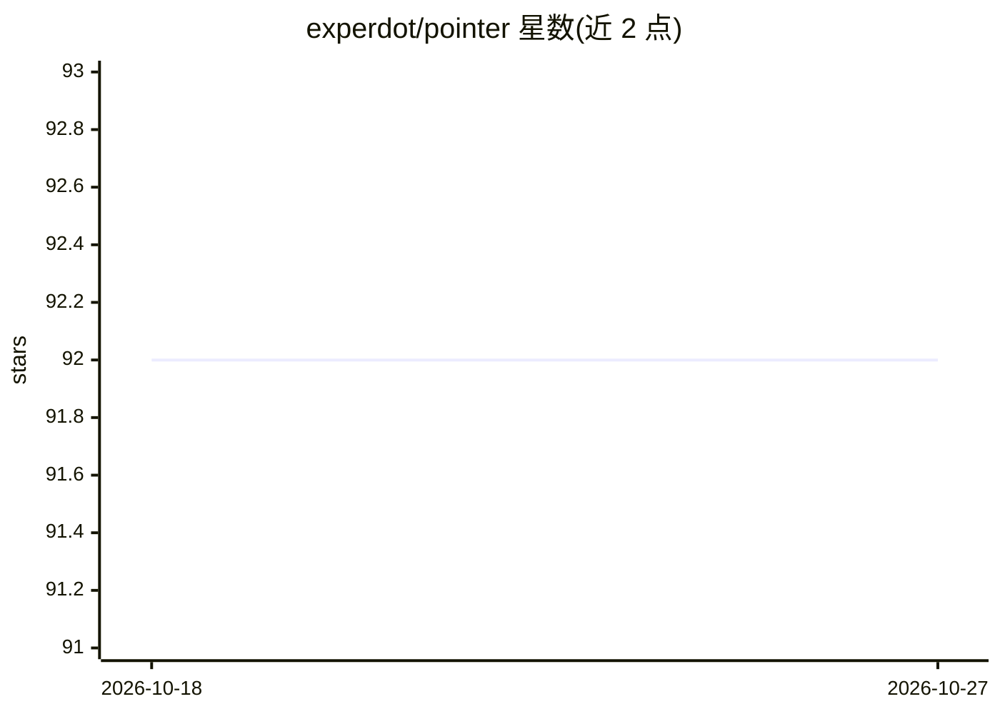

# experdot/pointer

⭐ 92 · TypeScript · MIT · 推送 2026-10-16 · [GitHub](https://github.com/experdot/pointer) · 个人维护 · 中文 README

**桌面 AI 聊天客户端：树状对话分支，对话以 Markdown 文件本地存储**

基于 Electron 35、React 19 与 TypeScript 的跨平台桌面 AI 聊天客户端，连接任意 OpenAI 兼容 API（OpenAI、DeepSeek 及兼容网关），支持为每条消息单独选择模型、可混用多模型。对话历史以树状分支组织，重新生成或继续会生成兄弟分支。所有对话保存为工作区普通文件夹内的 .pointer.md Markdown 文件，数据全部留在本地，可被外部编辑器修改并自动同步回 UI。当前 CI 仅自动发布 Windows 安装包，macOS/Linux 需本地构建。

## 筛选速览

| 维度 | 判定 | 备注 |
|---|---|---|
| AI 角色 | `ai-native` | 本体是模型或模型工具 |
| 许可风险 | `permissive` | MIT |
| 部署形态 | `desktop` | 安装包/桌面程序 |
| 模型依赖 | — | README 未给出锁定关系 |
| 硬件要求 | — | 无带数字的原话,不猜 |
| 安装摩擦 | `low` | 无编译、无系统依赖或容器化 |
| 成熟度 | — | 结构信号不足 |

## 能力要点

- 树状对话分支，可切换分支并沿所选路径继承上下文
- 每条消息可选不同 LLM，同一对话可混用多模型
- 对话以普通 Markdown 文件存于本地工作区，可同步或提交 git
- 导入 ChatGPT（OpenAI 导出）、DeepSeek 与 Pointer 数据，多维导出格式

## 适用场景

- 在本地桌面应用中与多家 LLM 服务对话且数据不上传
- 对比多个模型在同一对话中的回答
- 用 Markdown 文件管理与备份自己的 AI 对话记录

## 场景标签

`聊天机器人` · 领域:对话与助手

## 证据(README 行号)

> L15: Pointer is a cross-platform desktop AI chat client built with Electron 35, React 19 and TypeScript. It talks to any
> L42: - Import ChatGPT (OpenAI export), DeepSeek and Pointer data

## 星数曲线

2026-10-18 92 → 2026-10-27 92（+0）

---
*卡片 v1 · prompt 1.4 · 生成 2026-10-23 · 置信度 high · 依据 README sha `79a9ef8a9405` · [字段定义](../../DATASET.md)*
