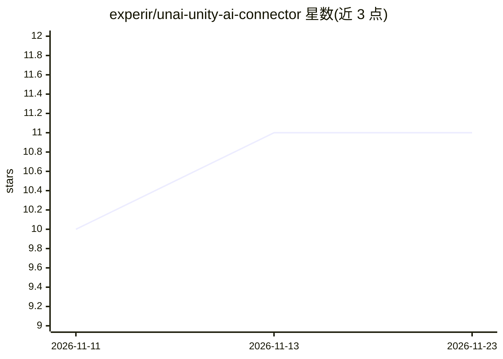

# experir/unai-unity-ai-connector

⭐ 11 · C# · MIT · 推送 2026-11-13 · [GitHub](https://github.com/experir/unai-unity-ai-connector) · 个人维护

**Unity 开发者的统一 C# LLM 接入包：运行时对话、Agent、编辑器助手与 MCP 一体**

面向 Unity 开发者的 AI 接入包：通过统一 C# API 连接 OpenAI、Anthropic、Gemini、Mistral、Cohere 等云端模型与 Ollama、LM Studio、llama.cpp 等本地运行时，一行代码切换提供者。提供四种使用方式：运行时聊天调用、带工具调用与记忆的多步推理 Agent 系统、内置 32 个工具的编辑器 AI 助手窗口、以及通过本地 HTTP 暴露 Unity 工具的 MCP 服务器。纯 C# 实现，无 Node.js/Python/外部进程依赖。需 Unity 6+ 与 Newtonsoft JSON 包。

## 筛选速览

| 维度 | 判定 | 备注 |
|---|---|---|
| AI 角色 | `ai-ecosystem` | LLM/agent 周边工具 |
| 许可风险 | `permissive` | MIT |
| 部署形态 | `None` |  |
| 模型依赖 | local-ok | 支持本地模型 |
| 硬件要求 | — | 无带数字的原话,不猜 |
| 安装摩擦 | `low` | 无编译、无系统依赖或容器化 |
| 成熟度 | — | 结构信号不足 |

## 能力要点

- 统一 C# API 覆盖 9 类提供者，运行时可切换并支持备份故障转移链
- AI Agent 系统：工具调用、对话记忆、observe-think-act 循环
- 编辑器内置 AI 助手，含 32 个场景/对象/组件/材质工具
- 内置 MCP 服务器（C# HttpListener）与 Agent HTTP API，可接入 MCP 客户端

## 适用场景

- 给游戏 NPC 加多步推理、工具使用与对话记忆
- 用 Claude Desktop/Cursor 等 MCP 客户端检查修改 Unity 工程
- 本地模型快速原型验证，上线切换云端 API
- 在 Unity 内做聊天机器人与虚拟助手应用

## 场景标签

`聊天机器人` `Agent 框架` · 领域:Agent 开发

## 证据(README 行号)

> L14: Connect Unity to cloud and local AI models with a unified C# API. UNAI includes adapters for OpenAI, Anthropic, Goo
> L46: - **Runtime + Editor + Agent + MCP** — all built on the same `IUnaiProvider` interface and `IUnaiTool` system

## 星数曲线

2026-11-11 10 → 2026-11-23 11（+1）

---
*卡片 v1 · prompt 1.4 · 生成 2026-11-19 · 置信度 high · 依据 README sha `2de54a02e45a` · [字段定义](../../DATASET.md)*
