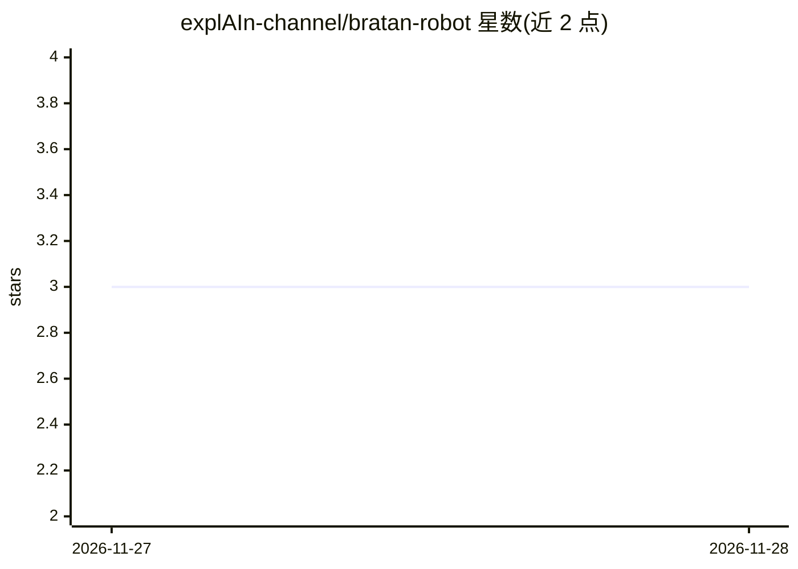

# explAIn-channel/bratan-robot

⭐ 3 · Python · MIT · 推送 2026-10-23 · [GitHub](https://github.com/explAIn-channel/bratan-robot) · [官网](https://www.youtube.com/@explAIn_ru) · 个人维护

**用二手扫地机+安卓手机+3D打印柯基外壳做的自主家庭机器人**

基于小米扫地机底盘的自主家庭机器人：Allwinner A33 板运行 C 实时控制（50 Hz 轮速/陀螺仪/急停），Snapdragon 845 手机经 Ubuntu chroot 运行地图、定位（Gauss–Newton 距离场）、A* 路径规划、YOLO 视觉与语音链路（Vosk 唤醒→Silero VAD→Azure STT/TTS，支持打断），ESP32 三麦克风阵列做声源定向，LLM（DeepSeek via OpenRouter）每数秒决策行为并带需求、记忆与"梦境"。针对单一机器人单一住宅调优，作者定位为一组可用部件而非套件。

## 筛选速览

| 维度 | 判定 | 备注 |
|---|---|---|
| AI 角色 | `ai-enhanced` | 去掉 AI 部分产品仍成立 |
| 许可风险 | `permissive` | MIT |
| 部署形态 | `library` | 以包/库形式分发 |
| 模型依赖 | locked-api |  |
| 硬件要求 | — | 无带数字的原话,不猜 |
| 安装摩擦 | `low` | 无编译、无系统依赖或容器化 |
| 成熟度 | — | 结构信号不足 |

## 能力要点

- Delta-2D 激光雷达 5 cm 占据栅格建图与逐扫描定位，家具移动数扫描内更新
- Vosk 唤醒 + Azure STT/TTS 语音链路，支持 barge-in 打断与自声空间陷波（RobotNull）
- YOLO26n 人物检测、YuNet+SFace 人脸识别、YAMNet 环境声分类
- ESP32+3×INMP441 麦克风阵列做声源定向（均误差约16°），固件含 OTA 回滚

## 适用场景

- 参考其架构用扫地机底盘与手机 DIY 一台家庭机器人
- 复用其激光雷达定位/路径规划模块做室内导航实验
- 搭建带打断能力的本地语音交互与麦克风阵列方案

## 场景标签

`语音 Agent` · 领域:对话与助手

## 证据(README 行号)

> L5: **An autonomous home robot built on a used robot-vacuum chassis, with an Android phone instead of a computer and a 3
> L6: Lidar mapping and localization, path planning and docking, YOLO vision, a voice you can interrupt, an ESP32 micropho
> L99: Fast things run locally, slow things in the cloud. The board keeps the motors and the emergency stop without the ph

## 星数曲线

2026-11-27 3 → 2026-11-28 3（+0）

---
*卡片 v1 · prompt 1.4 · 生成 2026-11-27 · 置信度 mid · 依据 README sha `9bfe9660a2a5` · [字段定义](../../DATASET.md)*
