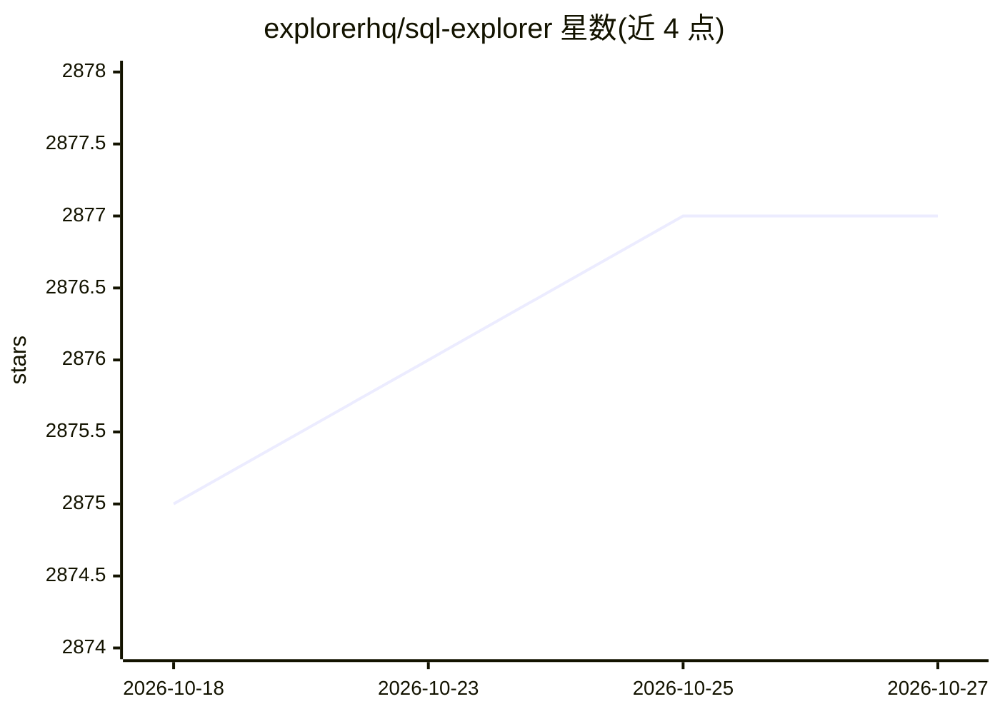

# explorerhq/sql-explorer

⭐ 2,877 · Python · NOASSERTION · 推送 2026-10-18 · [GitHub](https://github.com/explorerhq/sql-explorer) · [官网](https://www.sqlexplorer.io) · 组织维护

**面向 Django 的 SQL 查询与报表工具，含 AI SQL 助手**

基于 Django 的 SQL 报表应用，可加入现有 Django 站点或作为独立 BI 工具使用。支持多数据源连接：Django 支持的任意 SQL 数据库，以及用户上传的 CSV、JSON、SQLite 文件。提供浏览器内 SQL 编辑器（含 schema 提示与自动补全）、定时快照、查询历史、统计/透视表/散点图、参数化查询生成表单、结果邮件发送与 JSON API 输出。添加 OpenAI（或其他厂商）API key 后可用 LLM 驱动的 SQL 助手辅助编写和调试查询，自动注入相关上下文与 schema。

## 筛选速览

| 维度 | 判定 | 备注 |
|---|---|---|
| AI 角色 | `ai-enhanced` | 去掉 AI 部分产品仍成立 |
| 许可风险 | `none` | NOASSERTION |
| 部署形态 | `self-host` | docker 或自建部署 |
| 模型依赖 | — | README 未给出锁定关系 |
| 硬件要求 | — | 无带数字的原话,不猜 |
| 安装摩擦 | `low` | 无编译、无系统依赖或容器化 |
| 成熟度 | — | 结构信号不足 |

## 能力要点

- 连接 Django 支持的任意 SQL 数据库及上传的 CSV/JSON/SQLite
- LLM 驱动的 SQL 助手，自动注入 schema 上下文
- 定时快照、查询历史与日志
- 浏览器内统计、透视表、散点图与参数化查询

## 适用场景

- 在团队内编写并共享 SQL 查询与报表
- 让不熟悉 SQL 的同事通过参数化查询界面取数
- 用 AI 助手辅助编写和调试 SQL

## 场景标签

`数据分析` · 领域:效率与自动化

## 证据(README 行号)

> L45: simple, and confusion-free. It is a Django-based application that you
> L54: Add an OpenAI (or other provider) API key and get an LLM-powered

## 星数曲线

2026-10-18 2,875 → 2026-10-27 2,877（+2）

---
*卡片 v1 · prompt 1.4 · 生成 2026-10-21 · 置信度 high · 依据 README sha `60ee70c1a069` · [字段定义](../../DATASET.md)*
