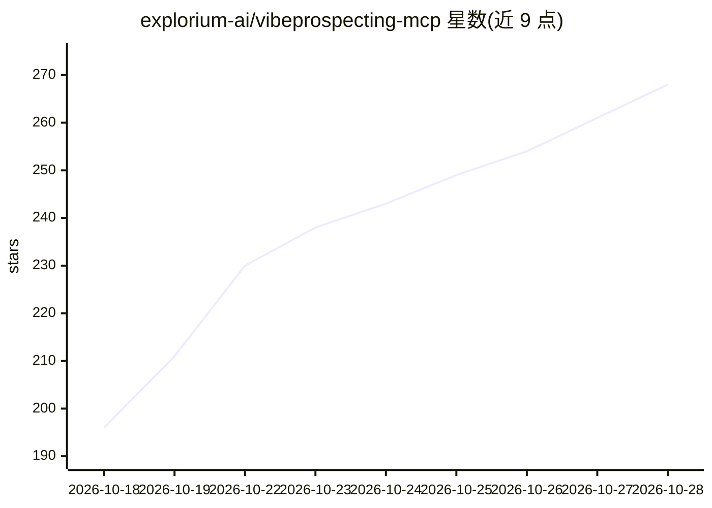

# explorium-ai/vibeprospecting-mcp

⭐ 268 · JavaScript · MIT · 推送 2026-09-15 · [GitHub](https://github.com/explorium-ai/vibeprospecting-mcp) · [官网](https://vibeprospecting.ai) · 组织维护

**接入 AI 助手的 B2B 数据 MCP 服务器：建线索名单、查企业、丰富联系人**

Explorium 提供的远程 MCP 服务器，通过单一 URL 与浏览器 OAuth 登录接入 Claude Code、Claude Desktop、Codex CLI、Gemini CLI、Manus、Hermes 等 AI 客户端，无需本地运行或管理 API key。功能包括按名称/行业/规模等条件查找公司、发现并丰富联系人（角色、画像、购买信号）、企业研究（firmographics、融资、竞品）及 CSV 导出。所有查询先返回 5–10 行样本预览，导出完整数据集时消耗额度。旧版本地 stdio 安装方式已弃用。

## 筛选速览

| 维度 | 判定 | 备注 |
|---|---|---|
| AI 角色 | `ai-ecosystem` | LLM/agent 周边工具 |
| 许可风险 | `permissive` | MIT |
| 部署形态 | `None` |  |
| 模型依赖 | — | README 未给出锁定关系 |
| 硬件要求 | — | 无带数字的原话,不猜 |
| 安装摩擦 | `low` | 无编译、无系统依赖或容器化 |
| 成熟度 | — | 结构信号不足 |

## 能力要点

- 远程 MCP 服务器，单一 URL + 浏览器 OAuth 认证，无本地组件
- 支持按行业/规模/地点/技术栈等条件查找公司并丰富联系人
- 样本预览先行（5–10 行），显式导出时才消耗额度生成 CSV

## 适用场景

- 在 AI 助手对话中直接构建 B2B 线索名单并导出 CSV
- 调研目标公司的规模、融资、技术栈与业务挑战
- 查找并丰富特定公司的决策者联系人信息

## 场景标签

`数据分析` · 领域:效率与自动化

## 证据(README 行号)

> L7: Vibe Prospecting is a **remote MCP server**. There's nothing to run locally and no API key to manage — you connect o
> L9: > **MCP endpoint:** `https://vibeprospecting.explorium.ai/mcp`
> L5: **Power your chat with live B2B data — build lead lists, research companies, enrich contacts, and personalize outrea

## 星数曲线

2026-10-18 196 → 2026-10-28 268（+72）

---
*卡片 v1 · prompt 1.4 · 生成 2026-10-22 · 置信度 high · 依据 README sha `01a9e513e24d` · [字段定义](../../DATASET.md)*
