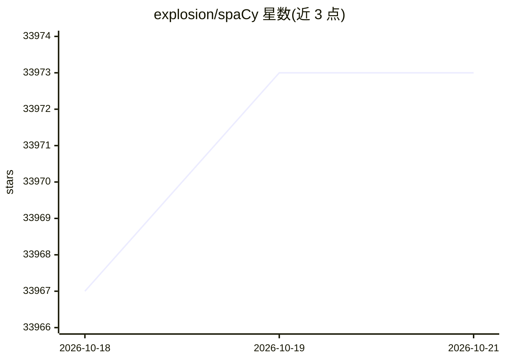

# explosion/spaCy

⭐ 33,973 · Python · MIT · 推送 2026-10-12 · [GitHub](https://github.com/explosion/spaCy) · [官网](https://spacy.io) · 组织维护

**Python 开发者的工业级 NLP 处理库**

Python/Cython 编写的自然语言处理库，提供预训练流水线，支持 70+ 语言的分词与训练，内置分词、词性标注、依存句法分析、命名实体识别、文本分类、实体链接等组件，支持与 BERT 等预训练 transformer 进行多任务学习，并包含训练系统与模型打包、部署和工作流管理功能。采用 MIT 许可证，可通过 pip、conda 安装或从源码编译，另有商业定制服务。

## 筛选速览

| 维度 | 判定 | 备注 |
|---|---|---|
| AI 角色 | `ai-native` | 本体是模型或模型工具 |
| 许可风险 | `permissive` | MIT |
| 部署形态 | `library` | 以包/库形式分发 |
| 模型依赖 | — | README 未给出锁定关系 |
| 硬件要求 | — | 无带数字的原话,不猜 |
| 安装摩擦 | `high` | 编译与系统依赖俱全 |
| 成熟度 | — | 结构信号不足 |

## 动量与使用信号

- 维护:`active` — 距上次 push 6.1 天,年发版 9,388 位贡献者
- 涨星:近 1 天 **+0**(自 20261016 起算)
- 安装:pypi 包 `spacy` 月下载 21,031,853

## 能力要点

- 支持 70+ 语言的分词与训练，提供多语言预训练流水线
- 内置命名实体识别、句法分析、文本分类等 NLP 组件
- 支持 PyTorch、TensorFlow 等框架的自定义模型
- 提供训练系统与模型打包、部署、工作流管理

## 适用场景

- 在 Python 项目中做分词、词性标注与依存句法分析
- 训练自己的命名实体识别或文本分类模型
- 下载预训练流水线快速处理多语言文本
- 把训练好的模型打包集成到生产应用中

## 场景标签

`模型训练` · 领域:训练与推理

## 证据(README 行号)

> L3: spaCy is a library for **advanced Natural Language Processing** in Python and
> L9: state-of-the-art speed and **neural network models** for tagging, parsing,
> L74: - Production-ready **training system**

## 星数曲线

2026-10-18 33,967 → 2026-10-21 33,973（+6）

---
*卡片 v1 · prompt 1.4 · 生成 2026-10-18 · 置信度 high · 依据 README sha `d5f4e9dac30e` · [字段定义](../../DATASET.md)*
