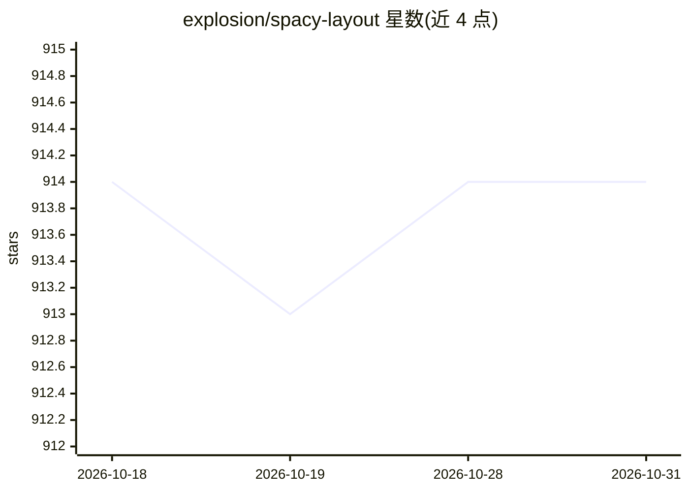

# explosion/spacy-layout

⭐ 914 · Python · MIT · 推送 2026-03-27 · [GitHub](https://github.com/explosion/spacy-layout) · 组织维护

**spaCy 插件：将 PDF/Word 等文档转为结构化 Doc 对象**

面向 spaCy 用户的文档结构化处理库，集成 Docling 将 PDF、Word 等格式转换为带布局信息的 spaCy Doc 对象，输出带标签的文本片段（章节、标题等）与表格，表格数据转为 pandas.DataFrame，并支持 Markdown 表示。可接续 spaCy 组件做命名实体识别、文本分类等，也用于 RAG 分块。支持批量 pipe 处理与 DocBin 二进制序列化。要求 Python 3.10 及以上。

## 筛选速览

| 维度 | 判定 | 备注 |
|---|---|---|
| AI 角色 | `ai-ecosystem` | LLM/agent 周边工具 |
| 许可风险 | `permissive` | MIT |
| 部署形态 | `library` | 以包/库形式分发 |
| 模型依赖 | — | README 未给出锁定关系 |
| 硬件要求 | — | 无带数字的原话,不猜 |
| 安装摩擦 | `low` | 无编译、无系统依赖或容器化 |
| 成熟度 | — | 结构信号不足 |

## 能力要点

- PDF/Word 等文档转结构化 spaCy Doc，含布局 span 与页码/边界框属性
- 表格提取并转为 pandas.DataFrame，可自定义表格文本渲染
- pipe 方法批量处理，DocBin 序列化避免重复转换
- 可与 spaCy 管线组件（NER、文本分类）衔接

## 适用场景

- 在 NLP 流水线中直接处理 PDF/Word 文档做实体识别或分类
- 为 RAG 管线从文档生成分块
- 批量转换并序列化文档以复用结构化结果

## 场景标签

`文档解析` · 领域:知识与检索

## 证据(README 行号)

> L3: This plugin integrates with Docling to bring structured processing of **PDFs**, **Word documents** and other input f
> L5: This workflow makes it easy to apply powerful **NLP techniques** to your documents, including linguistic analysis, n

## 星数曲线

2026-10-18 914 → 2026-10-31 914（+0）

---
*卡片 v1 · prompt 1.4 · 生成 2026-10-21 · 置信度 high · 依据 README sha `070a5312ab23` · [字段定义](../../DATASET.md)*
