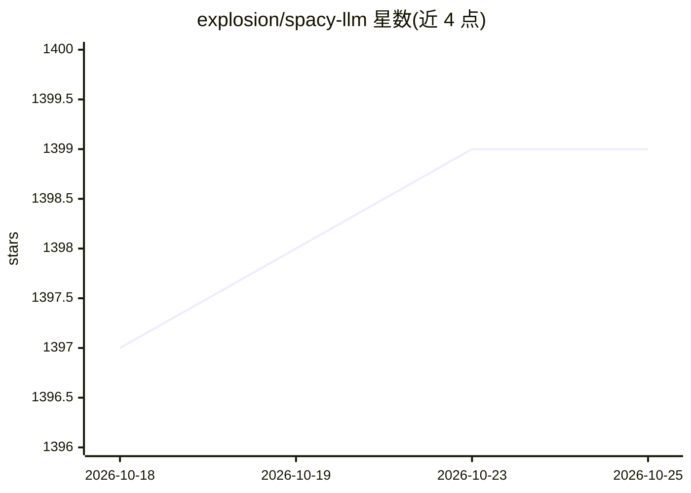

# explosion/spacy-llm

⭐ 1,399 · Python · MIT · 推送 2026-10-23 · [GitHub](https://github.com/explosion/spacy-llm) · [官网](https://spacy.io/usage/large-language-models) · 组织维护

**spaCy 集成 LLM 的结构化 NLP 管道库**

将大型语言模型接入 spaCy 管道的扩展包：提供可序列化的 llm 组件，把提示与解析模块化组合，将非结构化 LLM 回答转为 NLP 任务的稳定输出，无需训练数据。内置接入 OpenAI、Cohere、Anthropic、Google PaLM、Microsoft Azure AI 的 API，并支持 Hugging Face 托管的开源模型（Falcon、Llama 2、Mistral 等），可集成 LangChain。开箱提供 NER、文本分类、关系抽取等十余种任务。自声明为实验性包，接口可能在次版本更新中出现破坏性变更。

## 筛选速览

| 维度 | 判定 | 备注 |
|---|---|---|
| AI 角色 | `ai-ecosystem` | LLM/agent 周边工具 |
| 许可风险 | `permissive` | MIT |
| 部署形态 | `library` | 以包/库形式分发 |
| 模型依赖 | locked-api |  |
| 硬件要求 | — | 无带数字的原话,不猜 |
| 安装摩擦 | `low` | 无编译、无系统依赖或容器化 |
| 成熟度 | `idea` | |

## 能力要点

- 可序列化 llm 组件，将 LLM 输出解析为结构化 NLP 结果
- 接入 OpenAI/Cohere/Anthropic/PaLM/Azure AI 及 Hugging Face 开源模型
- 开箱支持 NER、文本分类、关系抽取、摘要、翻译等任务
- map-reduce 拆分超长提示并融合结果

## 适用场景

- 在 spaCy 管道中快速原型化 NLP 任务而无需标注训练数据
- LLM 组件与监督学习/规则组件混用，逐步替换以优化生产成本
- 通过 spaCy registry 自定义提示、解析与模型集成

## 场景标签

 · 领域:NLP/LLM 集成

## 证据(README 行号)

> L8: This package integrates Large Language Models (LLMs) into spaCy, featuring a modular system for **fast prototyping**
> L12: - Serializable `llm` **component** to integrate prompts into your spaCy pipeline
> L27: - Integration with LangChain 🦜️🔗 - all `langchain` models and features can be used in `spacy-llm`

## 星数曲线

2026-10-18 1,397 → 2026-10-25 1,399（+2）

---
*卡片 v1 · prompt 1.4 · 生成 2026-10-21 · 置信度 high · 依据 README sha `cb1c71969dca` · [字段定义](../../DATASET.md)*
