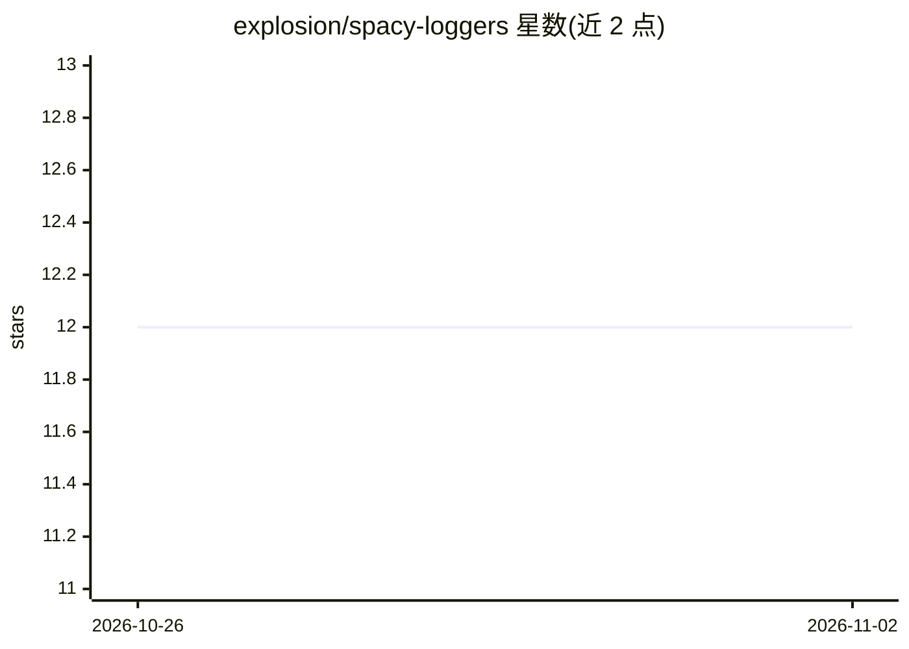

# explosion/spacy-loggers

⭐ 12 · Python · MIT · 推送 2026-10-26 · [GitHub](https://github.com/explosion/spacy-loggers) · 组织维护

**spaCy 训练日志工具包：对接 W&B/MLflow 等实验追踪平台**

从 spaCy v3.2 起拆分出的独立日志工具包，为 spaCy 训练过程提供面向 Weights & Biases、MLflow、ClearML、PyTorch、CuPy 的 logger 实现，另含 ChainLogger 等组合工具便于多个 logger 协同。各 logger 将训练配置、各组件分数、loss 曲线及最优/最新模型目录上报到对应平台，支持 remove_config_values 在上传前剔除指定路径字段。随 spaCy v3.2+ 自动安装，也可经 pip 或 conda-forge 单独安装。

## 筛选速览

| 维度 | 判定 | 备注 |
|---|---|---|
| AI 角色 | `ai-ecosystem` | LLM/agent 周边工具 |
| 许可风险 | `permissive` | MIT |
| 部署形态 | `library` | 以包/库形式分发 |
| 模型依赖 | — | README 未给出锁定关系 |
| 硬件要求 | — | 无带数字的原话,不猜 |
| 安装摩擦 | `medium` | 含编译或系统依赖之一 |
| 成熟度 | — | 结构信号不足 |

## 能力要点

- 提供 W&B / MLflow / ClearML / PyTorch / CuPy 五类 logger
- ChainLogger 工具 logger 支持多 logger 组合与控制台输出配置
- remove_config_values 可在上传前剔除配置中的路径等敏感字段
- spaCy v3.2+ 自动安装，也可 pip/conda 单独安装

## 适用场景

- spaCy 训练时把指标与配置同步到 W&B 或 MLflow 面板
- 用 ClearML 追踪并版本化训练数据集与模型工件
- 组合多个 logger 同时输出到控制台与实验平台

## 场景标签

`MLOps` · 领域:训练与推理

## 证据(README 行号)

> L5: Starting with spaCy v3.2, alternate loggers are moved into a separate package
> L9: `spacy-loggers` currently provides loggers for:

## 星数曲线

2026-10-26 12 → 2026-11-02 12（+0）

---
*卡片 v1 · prompt 1.4 · 生成 2026-11-01 · 置信度 high · 依据 README sha `aada3d89112e` · [字段定义](../../DATASET.md)*
