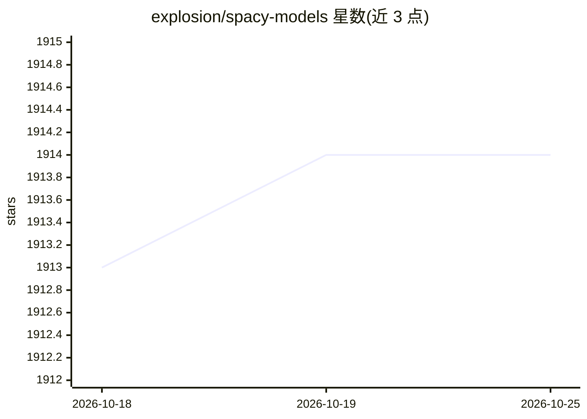

# explosion/spacy-models

⭐ 1,914 · Python · 推送 2026-03-20 · [GitHub](https://github.com/explosion/spacy-models) · [官网](https://spacy.io) · 组织维护

**spaCy NLP 库的官方模型发布仓库**

由 spaCy 团队维护的模型发布仓库：以 .whl 和 .tar.gz 形式在 GitHub Releases 中发布 spaCy 各版本对应的统计模型（词性标注、依存分析、词形还原、命名实体识别、词向量等），并通过 python -m spacy download 命令安装。模型按 [lang]_[type]_[genre]_[size] 命名约定组织，版本号首两位对齐 spaCy 版本，compatibility.json 用于兼容性检查。模型体积从 50 MB 到 1.33 GB 不等，许可包含 CC BY-SA 与 CC BY-NC。

## 筛选速览

| 维度 | 判定 | 备注 |
|---|---|---|
| AI 角色 | `ai-ecosystem` | LLM/agent 周边工具 |
| 许可风险 | `none` | — |
| 部署形态 | `library` | 以包/库形式分发 |
| 模型依赖 | — | README 未给出锁定关系 |
| 硬件要求 | — | 无带数字的原话,不猜 |
| 安装摩擦 | `low` | 无编译、无系统依赖或容器化 |
| 成熟度 | — | 结构信号不足 |

## 能力要点

- 覆盖 spaCy v1.x–v3.x 的多语言模型发布历史
- 模型按 type/genre/size 命名约定组织，版本号编码 spaCy 兼容性
- 支持 python -m spacy download、Python 包导入与手动安装三种方式

## 适用场景

- 为 spaCy 流水线下载预训练模型做 NLP 任务
- 查找特定 spaCy 版本兼容的模型版本
- 离线环境下手动下载并安装模型包

## 场景标签

 · 领域:NLP/预训练模型分发

## 证据(README 行号)

> L3: This repository contains
> L5: the spaCy NLP library. For more info on

## 星数曲线

2026-10-18 1,913 → 2026-10-25 1,914（+1）

---
*卡片 v1 · prompt 1.4 · 生成 2026-10-21 · 置信度 high · 依据 README sha `aa080e99b3db` · [字段定义](../../DATASET.md)*
