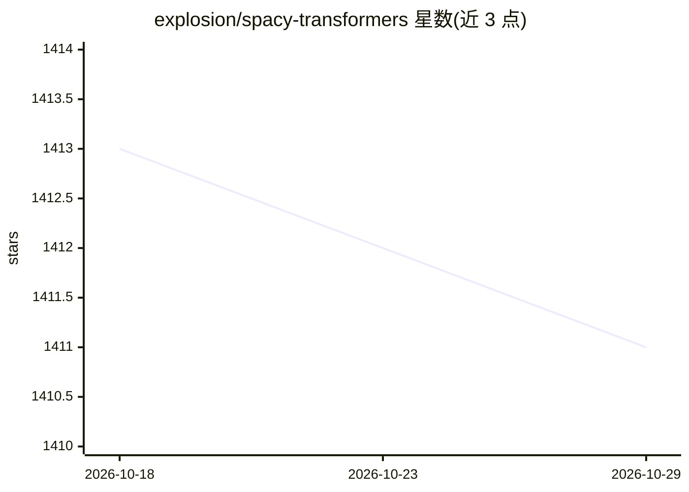

# explosion/spacy-transformers

⭐ 1,411 · Python · MIT · 推送 2026-10-23 · [GitHub](https://github.com/explosion/spacy-transformers) · [官网](https://spacy.io/usage/embeddings-transformers) · 组织维护

**让 spaCy 管线直接使用 Hugging Face 预训练 transformer 模型**

为 spaCy v3 提供 transformer 组件与模型架构：通过 Hugging Face transformers 接入 BERT、GPT-2、XLNet 等预训练模型作为 spaCy 管线的特征来源，自动将 transformer 输出对齐到 spaCy 分词，支持多组件回传的多任务学习、序列化与模型打包。限制：transformer 组件不提供任务专用头，需在 spaCy 内训练 ner/textcat 等组件；需 Python 3.6+、PyTorch v1.5+ 与 spaCy v3.0+。面向 NLP 开发者，pip 安装。

## 筛选速览

| 维度 | 判定 | 备注 |
|---|---|---|
| AI 角色 | `ai-ecosystem` | LLM/agent 周边工具 |
| 许可风险 | `permissive` | MIT |
| 部署形态 | `library` | 以包/库形式分发 |
| 模型依赖 | — | README 未给出锁定关系 |
| 硬件要求 | — | 无带数字的原话,不猜 |
| 安装摩擦 | `medium` | 含编译或系统依赖之一 |
| 成熟度 | — | 结构信号不足 |

## 能力要点

- BERT/RoBERTa/XLNet 等预训练模型接入 spaCy 管线
- 多任务学习：多个管线组件回传到同一 transformer
- transformer 输出与 spaCy 分词自动对齐
- 开箱即用的序列化与模型打包

## 适用场景

- 用预训练 transformer 增强 spaCy 的 NER/文本分类训练
- 在 spaCy v3 管线中替换词向量特征
- 将训练好的 transformer 管线打包分发

## 场景标签

`微调` · 领域:训练与推理

## 证据(README 行号)

> L3: This package provides spaCy components and
> L5: Hugging Face's `transformers` in

## 星数曲线

2026-10-18 1,413 → 2026-10-29 1,411（-2）

---
*卡片 v1 · prompt 1.4 · 生成 2026-10-21 · 置信度 high · 依据 README sha `c1a2f5967866` · [字段定义](../../DATASET.md)*
