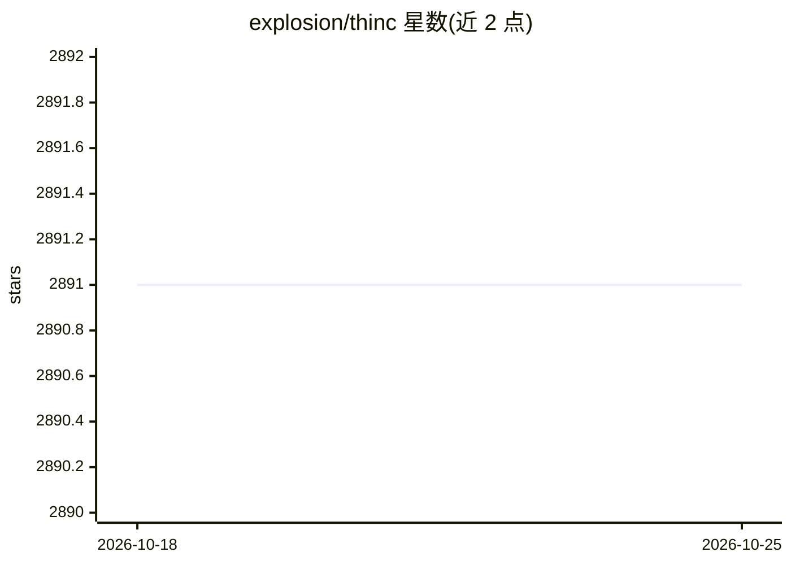

# explosion/thinc

⭐ 2,891 · Python · MIT · 推送 2026-03-27 · [GitHub](https://github.com/explosion/thinc) · [官网](https://thinc.ai) · 组织维护

**面向开发者的函数式深度学习库，可组合 PyTorch/TensorFlow/MXNet 模型**

由 spaCy 与 Prodigy 的开发团队维护的轻量级深度学习库，提供类型检查的函数式编程 API 用于组合模型，支持包装 PyTorch、TensorFlow、MXNet 定义的层或模型在其他框架网络中使用。可作接口层、独立工具包或开发自定义模型的方式。内置配置系统（描述对象树与超参数）、函数注册表、numpy/cupy 后端及 SGD/Adam/RAdam 优化器。通过 pip 安装，可运行于 Linux/macOS/Windows，源码构建需 C 编译器。多数示例为 Jupyter notebook，可在 Google Colab 上运行。

## 筛选速览

| 维度 | 判定 | 备注 |
|---|---|---|
| AI 角色 | `ai-ecosystem` | LLM/agent 周边工具 |
| 许可风险 | `permissive` | MIT |
| 部署形态 | `library` | 以包/库形式分发 |
| 模型依赖 | — | README 未给出锁定关系 |
| 硬件要求 | — | 无带数字的原话,不猜 |
| 安装摩擦 | `medium` | 含编译或系统依赖之一 |
| 成熟度 | — | 结构信号不足 |

## 能力要点

- 函数式模型组合 API，用组合而非继承，配 mypy 插件类型检查
- 包装 PyTorch/TensorFlow/MXNet 模型在统一网络中使用
- 集成配置系统与函数注册表，描述对象树和超参数
- numpy/cupy 可扩展后端，支持 SGD/Adam/RAdam 优化器

## 适用场景

- 在 PyTorch/TensorFlow 模型之上构建统一的组合式接口层
- 以函数式方式定义、配置和部署自定义模型
- 结合 Ray 做参数服务器式并行训练（示例 notebook）

## 场景标签

`模型训练` · 领域:训练与推理

## 证据(README 行号)

> L5: Thinc is a **lightweight deep learning library** that offers
> L7: with support for layers defined in other frameworks such as **PyTorch,

## 星数曲线

2026-10-18 2,891 → 2026-10-25 2,891（+0）

---
*卡片 v1 · prompt 1.4 · 生成 2026-10-21 · 置信度 high · 依据 README sha `35748e9b2b88` · [字段定义](../../DATASET.md)*
