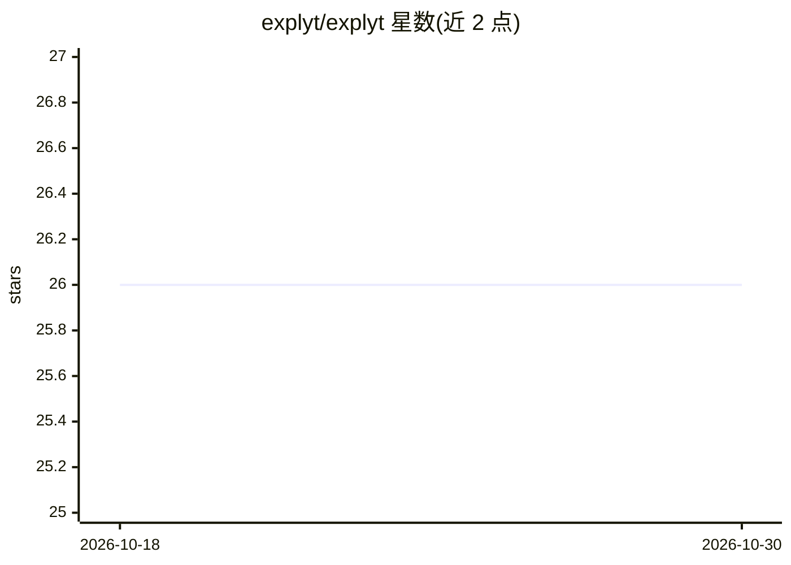

# explyt/explyt

⭐ 26 · 推送 2026-10-14 · [GitHub](https://github.com/explyt/explyt) · [官网](https://explyt.ai) · 组织维护

**JetBrains IDE 的 AI 编码代理：调试、重构与测试覆盖率提升**

以 JetBrains 插件形式提供的 AI agent，通过 IDE 已掌握的项目信息修复代码：可在调试器下运行代码查看变量、调用栈与执行路径，运行测试并以覆盖率反馈持续生成测试直至达标，执行 IDE 重构（如安全重命名），并用 IDE 静态分析审查代码改动。覆盖 IntelliJ IDEA、PyCharm、Rider、WebStorm 等多个 IDE，语言支持因 IDE 而异；模型可用官方托管或自带 API key（BYOK）。通过 JetBrains Marketplace 安装。

## 筛选速览

| 维度 | 判定 | 备注 |
|---|---|---|
| AI 角色 | `ai-native` | 本体是模型或模型工具 |
| 许可风险 | `none` | — |
| 部署形态 | `None` |  |
| 模型依赖 | — | README 未给出锁定关系 |
| 硬件要求 | — | 无带数字的原话,不猜 |
| 安装摩擦 | `low` | 无编译、无系统依赖或容器化 |
| 成熟度 | — | 结构信号不足 |

## 能力要点

- 调试器下检查变量值、调用栈与执行路径后再编辑
- 基于覆盖率反馈循环生成测试直至达到目标
- 应用 IDE 重构与内置静态分析审查 AI 改动
- 支持 Explyt 托管模型或自带 API key（BYOK）

## 适用场景

- 让 AI 修复失败测试或调试运行时问题
- 为 Java/Python/.NET 项目提升测试覆盖率
- 通过 IDE 安全重构并审查 AI 生成的代码改动

## 场景标签

`编码 Agent` `代码审查` · 领域:编码与开发

## 证据(README 行号)

> L9: AI agent for JetBrains IDEs: debugger, refactorings, and symbol navigation via IDE — fewer tokens, more precision
> L19: Explyt is an AI agent for JetBrains IDEs that fixes code with the project facts your IDE already knows.

## 星数曲线

2026-10-18 26 → 2026-10-30 26（+0）

---
*卡片 v1 · prompt 1.4 · 生成 2026-10-26 · 置信度 high · 依据 README sha `5350dbc5f53a` · [字段定义](../../DATASET.md)*
