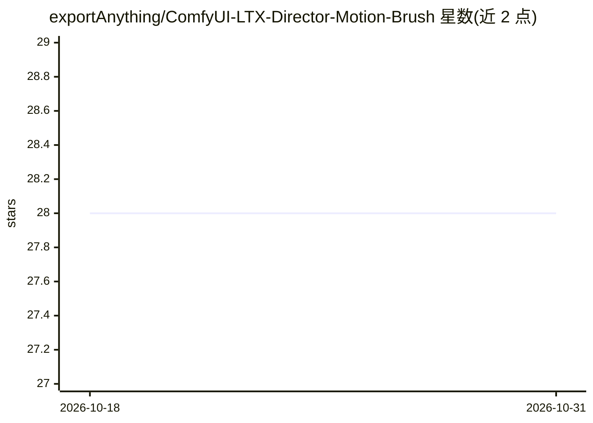

# exportAnything/ComfyUI-LTX-Director-Motion-Brush

⭐ 28 · JavaScript · GPL-3.0 · 推送 2026-06-27 · [GitHub](https://github.com/exportAnything/ComfyUI-LTX-Director-Motion-Brush) · 个人维护 · 中文 README

**ComfyUI 自定义节点包：为 LTX 2.3 视频生成添加 Motion Brush 运动轨迹控制**

基于 LTX Director v2（原作者 WhatDreamsCost）的 fork 节点包，面向使用 ComfyUI 进行 LTX 2.3 视频生成的用户。提供在故事板图像上逐帧绘制运动轨迹的 Motion Brush 时间线模式、稀疏轨迹引导渲染为 IC-LoRA 运动控制视频、引导注意力平衡、retake 源预览及防错辅助节点（长宽比锁定、防溢出默认边界等）。需另行安装 ComfyUI-LTXVideo、comfyui-kjnodes、ComfyUI-Impact-Pack 等节点及 LTX 2.3 模型、Lightricks IC-LoRA 文件；当前处于 Nightly 预览通道。

## 筛选速览

| 维度 | 判定 | 备注 |
|---|---|---|
| AI 角色 | `ai-ecosystem` | LLM/agent 周边工具 |
| 许可风险 | `viral` | GPL-3.0 |
| 部署形态 | `desktop` | 安装包/桌面程序 |
| 模型依赖 | — | README 未给出锁定关系 |
| 硬件要求 | — | 无带数字的原话,不猜 |
| 安装摩擦 | `low` | 无编译、无系统依赖或容器化 |
| 成熟度 | `idea` | |

## 能力要点

- Motion Brush 时间线模式：在故事板图像上直接绘制逐图运动轨迹
- 稀疏轨迹引导渲染为 LTX 2.3 IC-LoRA 运动控制视频
- 与上游 LTX Director v2 可共存（独立节点名与上传路由）
- 提供低显存与 GGUF 极低显存示例工作流及日文版

## 适用场景

- 在 ComfyUI 中为 LTX 2.3 视频添加逐图运动轨迹控制
- 制作带运动延续（motion carry）的转场效果
- 低显存环境下运行 LTX 2.3 运动控制工作流

## 场景标签

`视频生成` · 领域:内容生成

## 证据(README 行号)

> L3: Nightly ComfyUI node pack for LTX 2.3 timeline generation, per-image motion brush control, retake workflows, and mot
> L35: Install through ComfyUI-Manager once the Registry version is available, or clone this repo into your ComfyUI `custo
> L54: - `LTXDirectorMotionBrushV2` - the main rebuilt timeline editor with Motion Brush mode, retake support, matte clips

## 星数曲线

2026-10-18 28 → 2026-10-31 28（+0）

---
*卡片 v1 · prompt 1.4 · 生成 2026-10-26 · 置信度 high · 依据 README sha `c069971ffd13` · [字段定义](../../DATASET.md)*
