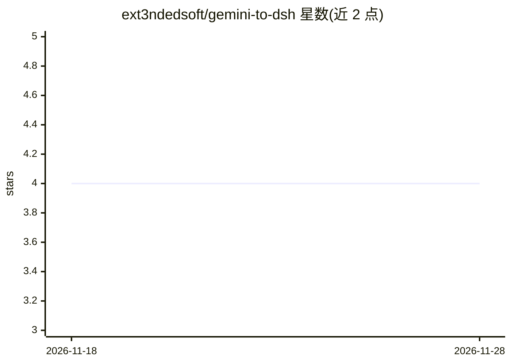

# ext3ndedsoft/gemini-to-dsh

⭐ 4 · JavaScript · MIT · 推送 2026-11-24 · [GitHub](https://github.com/ext3ndedsoft/gemini-to-dsh) · 个人维护

**把 Gemini 接入 DSH 及 OpenAI 兼容客户端的本地桥接器**

本地运行的 Node.js 桥接程序：通过 OpenAI 兼容接口将 Gemini 接入 DSH 及其他 OpenAI 协议客户端，支持流式、工具、图像输出。机制包括：多账号 OAuth 令牌轮转（按余额分配请求）、quota 面板显示五小时/周窗口用量、四种出网通道（smart-DNS/Proxy/VPN/Direct）及每两分钟自动探测切换的看门狗，另附 web-search 与 lean-context 插件。依赖 Node 20+，无第三方依赖；使用 Google AI Pro 订阅的 Cloud Code 非官方通道，README 声明该项目与 Google 无关。

## 筛选速览

| 维度 | 判定 | 备注 |
|---|---|---|
| AI 角色 | `ai-ecosystem` | LLM/agent 周边工具 |
| 许可风险 | `permissive` | MIT |
| 部署形态 | `None` |  |
| 模型依赖 | — | README 未给出锁定关系 |
| 硬件要求 | — | 无带数字的原话,不猜 |
| 安装摩擦 | `low` | 无编译、无系统依赖或容器化 |
| 成熟度 | — | 结构信号不足 |

## 能力要点

- OpenAI 兼容桥接：Gemini 接入 DSH 与任意 OpenAI 协议客户端
- 多账号轮转，在收到 429 前按余额分配请求
- 四种出网通道（DNS/Proxy/VPN/Direct）与看门狗自动切换
- quota 面板展示各账号用量窗口并切换出网方式

## 适用场景

- 让 DSH 使用 Gemini 模型作为后端
- Google 直连受限的网络环境下通过中继/代理访问 Gemini
- 管理多个 Gemini 账号的配额分配

## 场景标签

`模型网关` · 领域:Agent 开发

## 证据(README 行号)

> L9: **gemini-to-dsh** подключает Gemini к DSH и к любому клиенту, который говорит на OpenAI. Это небольшой локальный мос
> L15: - **Gemini в DSH** — стриминг, инструменты, изображения, размышления.

## 星数曲线

2026-11-18 4 → 2026-11-28 4（+0）

---
*卡片 v1 · prompt 1.4 · 生成 2026-11-21 · 置信度 high · 依据 README sha `7438e9ed2726` · [字段定义](../../DATASET.md)*
