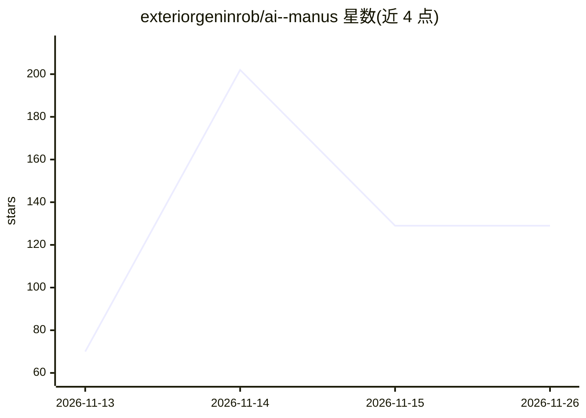

# exteriorgeninrob/ai--manus

⭐ 129 · Apache-2.0 · 推送 2026-11-15 · [GitHub](https://github.com/exteriorgeninrob/ai--manus) · 个人维护

**面向日常小任务的自主 AI Agent：代写并运行代码、控制浏览器**

README 描述的自主 AI Agent 系统，声称可在沙箱环境运行工具与操作：自主编写并执行脚本、控制浏览器（导航页面、填写表单、抓取信息）、执行多步骤任务，定位为个人助理，面向学习、家庭与轻量办公场景。README 以功能介绍与兼容性表为主，未提供安装命令、代码示例或技术实现细节，仅列出最低 4GB 内存等硬件兼容要求与上线步骤文字说明。

## 筛选速览

| 维度 | 判定 | 备注 |
|---|---|---|
| AI 角色 | `ai-native` | 本体是模型或模型工具 |
| 许可风险 | `permissive` | Apache-2.0 |
| 部署形态 | `None` |  |
| 模型依赖 | — | README 未给出锁定关系 |
| 硬件要求 | — | 无带数字的原话,不猜 |
| 安装摩擦 | `low` | 无编译、无系统依赖或容器化 |
| 成熟度 | — | 结构信号不足 |

## 能力要点

- 自主编写并执行代码完成任务
- 浏览器控制：导航、填表、抓取信息
- 代码与浏览器操作可在同一工作流中衔接
- 沙箱环境内运行工具与操作

## 适用场景

- 让 agent 代跑脚本和自动化小任务
- 自动浏览网页、填表、汇总多页信息
- 学习与轻量办公中的重复性工作委派

## 场景标签

`AI 助手` `编码 Agent` `浏览器自动化` · 领域:效率与自动化

## 证据(README 行号)

> L18: Manus is an autonomous AI agent designed to run code and control a browser on your behalf. Instead of acting like a
> L10: - **Autonomous Code Execution:** Manus AI agent runs code on its own to complete tasks, so you can focus on decisio

## 星数曲线

2026-11-13 70 → 2026-11-26 129（+59）

---
*卡片 v1 · prompt 1.4 · 生成 2026-11-17 · 置信度 low · 依据 README sha `0f78ee3a5dd2` · [字段定义](../../DATASET.md)*
