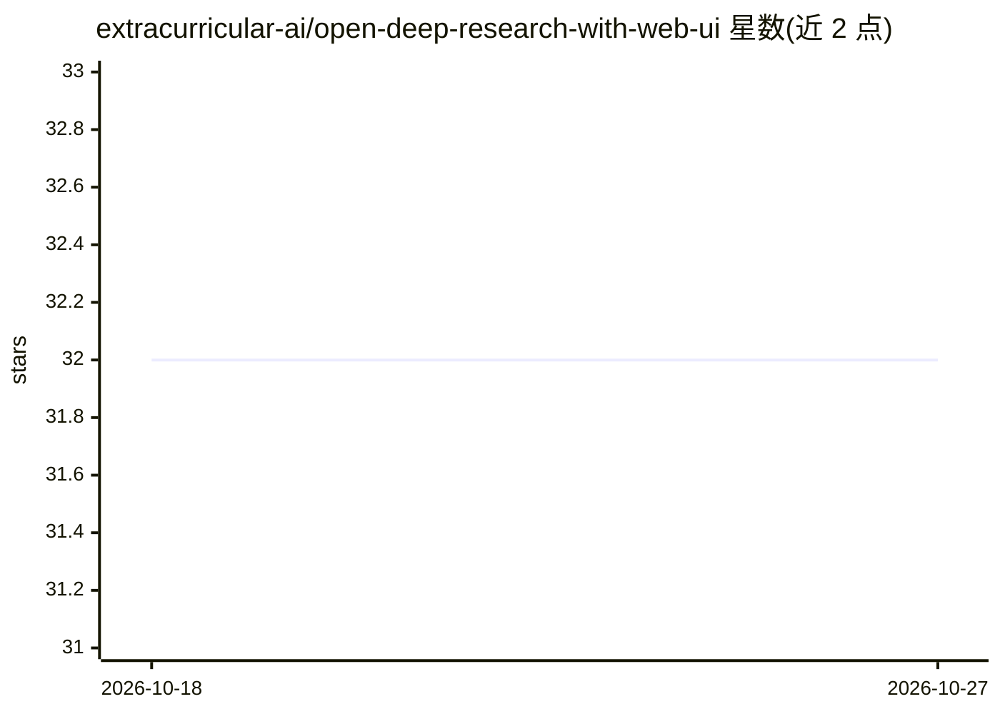

# extracurricular-ai/open-deep-research-with-web-ui

⭐ 32 · Python · NOASSERTION · 推送 2026-07-21 · [GitHub](https://github.com/extracurricular-ai/open-deep-research-with-web-ui) · 组织维护 · 中文 README

**自托管的深度研究 Agent，带 Web UI 并行后台跑研究任务**

基于 HuggingFace smolagents 改写的开源深度研究 Agent，复刻 OpenAI Deep Research 形态：Manager + 搜索子 Agent 的多智能体流水线，联网搜索后生成带推理过程的研究报告。支持 OpenAI、Anthropic、DeepSeek、Ollama 及任意 OpenAI 兼容端点；搜索侧提供 DuckDuckGo/SerpAPI/MetaSo/Tavily/Bocha 顺序回退链。特色是并行后台研究：多个任务同时在子进程运行、SQLite 持久化、关浏览器后可回放。提供 Docker 一键部署，需 FFmpeg 处理音频，GAIA 验证集 pass@1 为 55%。

## 筛选速览

| 维度 | 判定 | 备注 |
|---|---|---|
| AI 角色 | `ai-native` | 本体是模型或模型工具 |
| 许可风险 | `none` | NOASSERTION |
| 部署形态 | `self-host` | docker 或自建部署 |
| 模型依赖 | local-ok | 支持本地模型 |
| 硬件要求 | — | 无带数字的原话,不猜 |
| 安装摩擦 | `low` | 无编译、无系统依赖或容器化 |
| 成熟度 | — | 结构信号不足 |

## 能力要点

- Manager + 搜索子 Agent 多智能体流水线，SSE 流式输出
- 并行后台研究：多任务同时运行，SQLite 持久化与会话回放
- 多搜索引擎顺序回退链（DuckDuckGo 免 key 开箱可用）
- Docker 一键部署，无遥测，可配合 Ollama/vLLM 离线运行

## 适用场景

- 自托管一个深度研究服务，输入问题自动联网调研并产出报告
- 批量排队多个研究问题，稍后统一查看结果
- 内网/离线环境部署（Ollama 或自建 OpenAI 兼容端点）
- 团队共享同一实例，多用户并发提交研究任务

## 场景标签

`多智能体` `科研工具` · 领域:Agent 开发

## 证据(README 行号)

> L12: An open replication of OpenAI's Deep Research with a modern web UI — adapted from HuggingFace smolagents with simpl
> L16: This agent achieves **55% pass@1** on the GAIA validation set, compared to **67%** for OpenAI's Deep Research.
> L21: - **Multi-agent research pipeline** — Manager + search sub-agents with real-time streaming output

## 星数曲线

2026-10-18 32 → 2026-10-27 32（+0）

---
*卡片 v1 · prompt 1.4 · 生成 2026-10-26 · 置信度 high · 依据 README sha `a86a8022c74b` · [字段定义](../../DATASET.md)*
