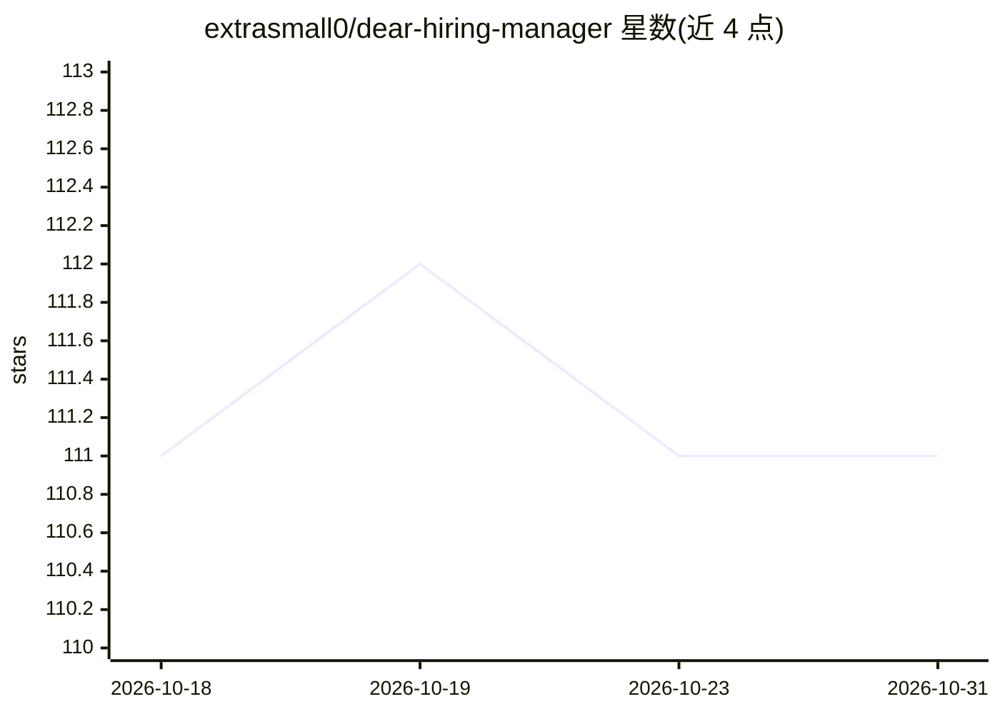

# extrasmall0/dear-hiring-manager

⭐ 111 · MIT · 推送 2026-07-15 · [GitHub](https://github.com/extrasmall0/dear-hiring-manager) · 个人维护

**本地运行的任务申请自动填写插件：按简历填表并起草求职信**

以 Claude Code 插件形式运行的求职申请自动化工具：读取职位描述并评估匹配度，从本地保存的个人档案（profile.md）自动填写申请表各字段，起草开放式回答与求职信，表单填好后停在提交按钮前，由用户完成最终发送。通过内置 Playwright 浏览器操作页面，数据全部存于本地文件，无需账号与云端；支持单次申请与批量模式，遇到登录墙、验证码等标记为受阻。可选用 Apify 抓取职位链接。

## 筛选速览

| 维度 | 判定 | 备注 |
|---|---|---|
| AI 角色 | `ai-native` | 本体是模型或模型工具 |
| 许可风险 | `permissive` | MIT |
| 部署形态 | `None` |  |
| 模型依赖 | — | README 未给出锁定关系 |
| 硬件要求 | — | 无带数字的原话,不猜 |
| 安装摩擦 | `low` | 无编译、无系统依赖或容器化 |
| 成熟度 | — | 结构信号不足 |

## 能力要点

- 读取职位描述并按最低匹配分决定是否填写表单
- 从本地 profile.md 填写表单，不确定字段标红提示
- 批量模式：每职位独立标签页，无人值守运行，停在提交前
- 从不点击 Submit、不绕过验证码、不编造简历外的内容

## 适用场景

- 我想自动填写多家公司的申请表，最后自己检查并提交
- 让我用统一档案批量投递，只处理被标记的受阻项
- 为单个职位生成贴合个人风格的求职信

## 场景标签

`浏览器自动化` `AI 写作` · 领域:效率与自动化

## 证据(README 行号)

> L4:  Claude Code plugin
> L13: It reads the job description, scores how well you fit, fills every field from your saved profile, and
> L14: drafts open-ended answers and a cover letter in your own voice. When the form is ready it parks the tab

## 星数曲线

2026-10-18 111 → 2026-10-31 111（+0）

---
*卡片 v1 · prompt 1.4 · 生成 2026-10-23 · 置信度 high · 依据 README sha `0c25250b9477` · [字段定义](../../DATASET.md)*
