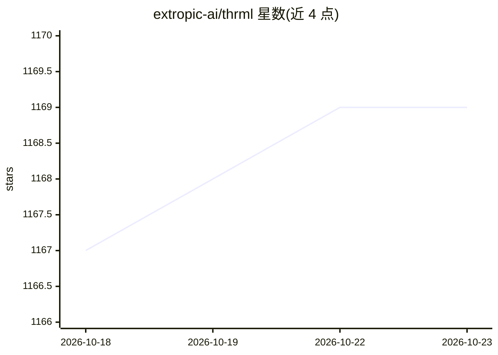

# extropic-ai/thrml

⭐ 1,169 · Python · Apache-2.0 · 推送 2026-10-20 · [GitHub](https://github.com/extropic-ai/thrml) · [官网](https://docs.thrml.ai/en/latest/) · 组织维护

**JAX 概率图模型构建与采样库，支持块 Gibbs 采样**

面向研究者的 Python/JAX 库，用于构建和采样概率图模型：提供稀疏异构图上的 GPU 加速块 Gibbs 采样、任意 PyTree 节点状态、异构图模型支持与离散能量模型工具。内部将因子交互编译为紧凑全局状态表示，减少 Python 循环、最大化数组级并行。Extropic 正开发针对离散 PGM 采样的专用硬件，本库可在当前 GPU 上原型化并对接未来硬件。需 Python 3.10+，pip 安装。

## 筛选速览

| 维度 | 判定 | 备注 |
|---|---|---|
| AI 角色 | `ai-native` | 本体是模型或模型工具 |
| 许可风险 | `permissive` | Apache-2.0 |
| 部署形态 | `library` | 以包/库形式分发 |
| 模型依赖 | — | README 未给出锁定关系 |
| 硬件要求 | — | 无带数字的原话,不猜 |
| 安装摩擦 | `low` | 无编译、无系统依赖或容器化 |
| 成熟度 | — | 结构信号不足 |

## 能力要点

- 概率图模型的块 Gibbs 采样（GPU 加速）
- 任意 PyTree 节点状态与异构图模型支持
- 离散能量模型（EBM）工具
- 因子交互编译为全局状态表示以提升 JAX 数组级并行

## 适用场景

- 在 GPU 上对稀疏离散 PGM 做块 Gibbs 采样实验
- 构建异构能量模型并采样
- 为未来 Extropic 采样硬件做原型验证

## 场景标签

 · 领域:机器学习/概率计算

## 证据(README 行号)

> L5: THRML is a JAX library for building and sampling probabilistic graphical models, with a focus on efficient block Gib
> L9: - Blocked Gibbs sampling for PGMs
> L12: - Discrete EBM utilities

## 星数曲线

2026-10-18 1,167 → 2026-10-23 1,169（+2）

---
*卡片 v1 · prompt 1.4 · 生成 2026-10-21 · 置信度 high · 依据 README sha `39070cabc306` · [字段定义](../../DATASET.md)*
