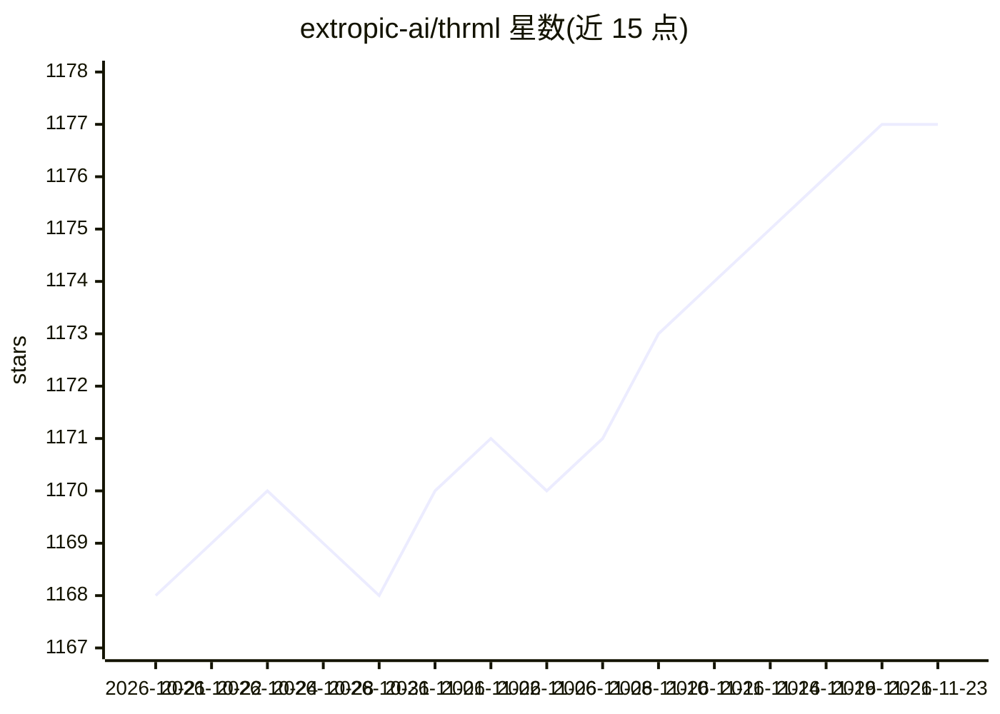

# extropic-ai/thrml

⭐ 1,177 · Python · Apache-2.0 · 推送 2026-11-10 · [GitHub](https://github.com/extropic-ai/thrml) · [官网](https://docs.thrml.ai/en/latest/) · 组织维护

**面向概率图模型的 JAX 库：构建与块吉布斯采样**

THRML 是一个 JAX 库，用于构建概率图模型并进行采样，聚焦块吉布斯采样与能量模型。内部将基于因子的交互编译为紧凑的全局状态表示，减少 Python 循环并利用 JAX 数组级并行，支持稀疏异构图上的 GPU 加速采样。维护方 Extropic 同时在开发用于离散 PGM 采样的硬件，THRML 提供面向该硬件的早期实验接口，采样后端可通过外部包接入。需要 Python 3.10+。

## 筛选速览

| 维度 | 判定 | 备注 |
|---|---|---|
| AI 角色 | `ai-native` | 本体是模型或模型工具 |
| 许可风险 | `permissive` | Apache-2.0 |
| 部署形态 | `library` | 以包/库形式分发 |
| 模型依赖 | — | README 未给出锁定关系 |
| 硬件要求 | — | 无带数字的原话,不猜 |
| 安装摩擦 | `low` | 无编译、无系统依赖或容器化 |
| 成熟度 | — | 结构信号不足 |

## 能力要点

- 针对 PGM 的块吉布斯采样（含 Ising 链两色分块示例）
- 支持异构图模型与任意 PyTree 节点状态
- 离散 EBM 工具
- 可插拔采样后端机制，支持外部包接入

## 适用场景

- 在 GPU 上对稀疏异构图上的 PGM 做块吉布斯采样
- 研究/构建离散能量模型（EBM）
- 为未来 Extropic 硬件做前期算法实验

## 场景标签

`推理引擎` · 领域:训练与推理

## 证据(README 行号)

> L5: THRML is a JAX library for building and sampling probabilistic graphical models, with a focus on efficient block Gib
> L9: - Blocked Gibbs sampling for PGMs
> L15: From a technical point of view, the internal structure compiles factor-based interactions to a compact "global" sta

## 星数曲线

2026-10-21 1,168 → 2026-11-23 1,177（+9）

---
*卡片 v1 · prompt 1.4 · 生成 2026-11-23 · 置信度 high · 依据 README sha `ccea0c0538ff` · [字段定义](../../DATASET.md)*
