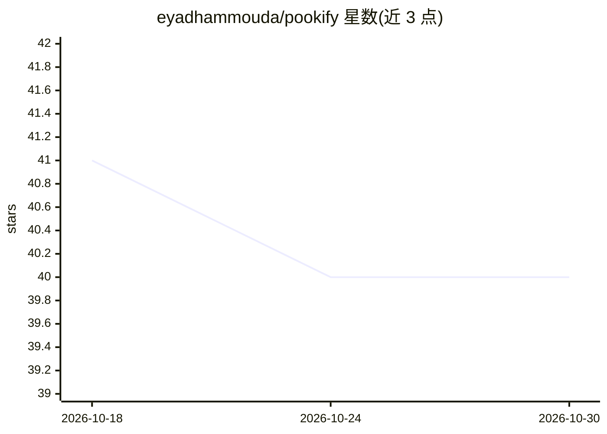

# eyadhammouda/pookify

⭐ 40 · Swift · NOASSERTION · 推送 2026-07-09 · [GitHub](https://github.com/eyadhammouda/pookify) · [官网](https://pookify.vercel.app/) · 个人维护

**在 MacBook 刘海处显示 Claude Code 会话状态的菜单栏应用**

macOS 原生 SwiftUI 应用，将多个 Claude Code 会话状态以 Dynamic Island 风格呈现在刘海区域：闭合态显示最需关注的会话与多会话计数徽章，悬停展开会话堆栈，等待授权的会话以琥珀色圆点标识并优先显示。机制上通过安装器向 ~/.claude/settings.json 注入钩子，编译型辅助程序 island-hook 将各会话事件写入状态 JSON，应用轮询该目录后绘制。支持终端与 VS Code 扩展中的 Claude Code，无刘海机型会自绘同比例刘海。源码构建需 Xcode Command Line Tools。

## 筛选速览

| 维度 | 判定 | 备注 |
|---|---|---|
| AI 角色 | `ai-ecosystem` | LLM/agent 周边工具 |
| 许可风险 | `none` | NOASSERTION |
| 部署形态 | `None` |  |
| 模型依赖 | — | README 未给出锁定关系 |
| 硬件要求 | — | 无带数字的原话,不猜 |
| 安装摩擦 | `low` | 无编译、无系统依赖或容器化 |
| 成熟度 | — | 结构信号不足 |

## 能力要点

- 通过 Claude Code 钩子 island-hook 写入每会话状态 JSON 并轮询绘制
- 多会话计数徽章与待授权琥珀色提示（受阻会话优先）
- 兼容终端与 VS Code 扩展中的多个 Claude Code 会话
- 无网络调用、无分析收集，完全本地运行

## 适用场景

- 同时在多个终端/编辑器中跑 Claude Code 时在刘海处一眼看到哪个会话需要我
- 等待授权提示时不漏掉被阻塞的会话
- 在无刘海 Mac 上获得同样的状态指示体验

## 场景标签

 · 领域:开发者工具/桌面应用

## 证据(README 行号)

> L7: The Claude Code dynamic Island for your MacBook.
> L66: Claude Code runs a hook each time something happens (a tool starts, a tool finishes, a turn ends, a prompt needs ap

## 星数曲线

2026-10-18 41 → 2026-10-30 40（-1）

---
*卡片 v1 · prompt 1.4 · 生成 2026-10-25 · 置信度 high · 依据 README sha `53a00f5dc5d7` · [字段定义](../../DATASET.md)*
