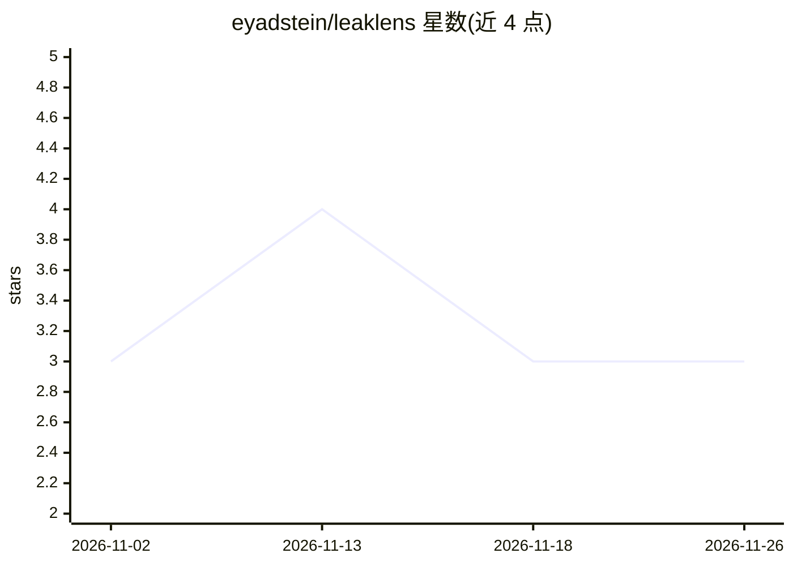

# eyadstein/leaklens

⭐ 3 · Python · MIT · 推送 2026-11-25 · [GitHub](https://github.com/eyadstein/leaklens) · [官网](https://eyadstein.github.io/leaklens/) · 个人维护

**机器学习数据泄漏审计工具：扫描数据集、切分与代码中的泄漏**

LeakLens 审计数据泄漏常藏身的三个位置：数据集、训练/测试切分与建模代码，可选引擎覆盖 SQL、图像、文本、深度学习与流水线元数据。检测为确定性、本地、CPU 优先：静态解析代码而不执行，数据不离开本机。发现带严重度、证据与稳定指纹，支持基线对比、抑制与信任评分（100 起扣分），退出码契约使同一命令可用于本地与 CI。以 PyPI 包提供 CLI、Python API、GitHub Action，可选 extras 提供 FastAPI 服务与 Streamlit UI。

## 筛选速览

| 维度 | 判定 | 备注 |
|---|---|---|
| AI 角色 | `ai-ecosystem` | LLM/agent 周边工具 |
| 许可风险 | `permissive` | MIT |
| 部署形态 | `library` | 以包/库形式分发 |
| 模型依赖 | — | README 未给出锁定关系 |
| 硬件要求 | — | 无带数字的原话,不猜 |
| 安装摩擦 | `low` | 无编译、无系统依赖或容器化 |
| 成熟度 | — | 结构信号不足 |

## 能力要点

- 静态解析 .py/.ipynb 代码检测切分前拟合、测试集调参、时序乱序等泄漏模式
- 数据集与切分审计：目标泄漏、行重叠、实体/时间重叠、缺失值关联
- 带证据与指纹的发现模型，支持基线、抑制与信任评分退出门
- GitHub Action 与 JSON Schema 报告便于 CI 集成

## 适用场景

- 在 CI 中扫描 ML 仓库，阻止带泄漏的代码合入
- 训练前审计 train/test 切分是否存在行或实体重叠
- 审查 notebook 中的预处理顺序与时间序列切分

## 场景标签

`MLOps` · 领域:训练与推理

## 证据(README 行号)

> L12: **Find data leakage before it inflates your metrics.** LeakLens audits the three places leakage hides — datasets, t
> L86: LeakLens is a set of surface-scoped engines around one finding model. Intake normalizes an input, one engine audits
> L137: |`arena`|model arena: drops flagged columns, trains three model families in leak-safe pipelines, tracked in MLflow

## 星数曲线

2026-11-02 3 → 2026-11-26 3（+0）

---
*卡片 v1 · prompt 1.4 · 生成 2026-11-22 · 置信度 high · 依据 README sha `443ed6a128c5` · [字段定义](../../DATASET.md)*
