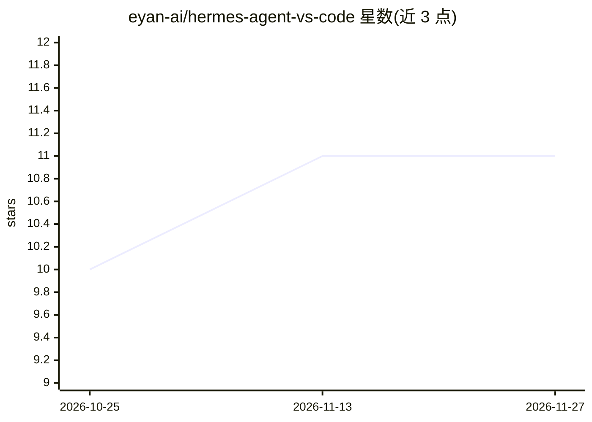

# eyan-ai/hermes-agent-vs-code

⭐ 11 · JavaScript · MIT · 推送 2026-10-22 · [GitHub](https://github.com/eyan-ai/hermes-agent-vs-code) · 个人维护

**在 VS Code 侧边栏接入 Hermes Agent 的社区扩展**

将 Hermes Agent 以聊天侧边栏形式集成到 VS Code：提供编辑器上下文注入（当前文件/选区）、@ 工作区搜索与本地附件、结构化 Thinking/Action 时间线、审批与 Diff 审核流程、会话持久化与记忆/技能管理。依赖本地安装的 Hermes CLI（默认经 ACP 传输），后台任务续跑需独立 Node.js。面向已在 VS Code 中使用 Hermes Agent 的开发者。

## 筛选速览

| 维度 | 判定 | 备注 |
|---|---|---|
| AI 角色 | `ai-ecosystem` | LLM/agent 周边工具 |
| 许可风险 | `permissive` | MIT |
| 部署形态 | `None` |  |
| 模型依赖 | — | README 未给出锁定关系 |
| 硬件要求 | — | 无带数字的原话,不猜 |
| 安装摩擦 | `low` | 无编译、无系统依赖或容器化 |
| 成熟度 | — | 结构信号不足 |

## 能力要点

- ACP 流式对话 UI，结构化 Thinking 与 Action 时间线
- 编辑器上下文注入与 @ 工作区搜索、本地附件
- 审批/Diff/文档审核流程与停止/队列/转向控制
- 会话恢复与关闭 VS Code 后的后台任务续跑（需 Node.js）

## 适用场景

- 在编辑器内与 Hermes Agent 对话处理代码任务
- 敏感代码修改前通过审批和 Diff 流程把关
- 跨会话保留项目上下文与个人工作偏好

## 场景标签

`编码 Agent` · 领域:编码与开发

## 证据(README 行号)

> L54: The extension requires a local Hermes Agent CLI installation. ACP is the default transport for structured Thinking,
> L67: The extension sends the user prompt, selected skill, attachments, and current editor context to Hermes. If ACP is u

## 星数曲线

2026-10-25 10 → 2026-11-27 11（+1）

---
*卡片 v1 · prompt 1.4 · 生成 2026-11-18 · 置信度 high · 依据 README sha `72cf6390a785` · [字段定义](../../DATASET.md)*
